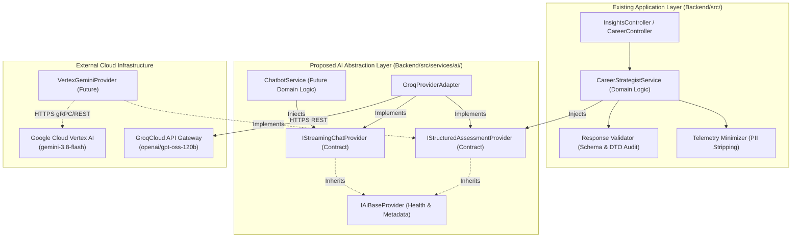

# Stage 2A.14 — Provider Abstraction Contract Extraction & Review

**Project:** Evolexa Career Strategist / Job Tracker  
**Role:** Senior Backend Architect & AI Integration Engineer  
**Subsystem Scope:** AI Provider Abstraction Layer (`Backend/src/services/ai/`)  
**Execution Mode:** STRICTLY READ-ONLY ASSESSMENT & ARCHITECTURAL REVIEW  
**Date:** November 5, 2026  
**Status:** COMPLETE — CONTRACT SPECIFICATION PREPARED FOR ARCHITECTURAL APPROVAL  

---

## 1. Executive Summary

This document extracts and formalizes the complete proposed **AI Provider Abstraction Contract** for the Evolexa platform following the Stage 2A.12 AI Provider Selection Assessment.

In Stage 2A.12, the architecture team selected **Option 3: Groq Primary with Decoupled Abstraction Layer**, designating `openai/gpt-oss-120b` via GroqCloud as the primary operational engine while mandating that all application controllers and domain services interact exclusively with a vendor-neutral provider contract.

This review presents:
1. **The Exact Architectural Boundary:** Explicitly separating existing repository code from proposed abstraction contracts.
2. **The Complete Interface & DTO Specification:** Covering structured assessment generation, conversational streaming, error taxonomy, cancellation, and rate-limit metadata.
3. **Resolution of the Unified vs. Separate Interface Question:** An architectural evaluation recommending **Option C: Base Provider with Capability-Specific Extensions** (`IStructuredAssessmentProvider` & `IStreamingChatProvider`).
4. **Normalized Error & Fallback Contract:** Precise rules governing retry boundaries, circuit breaking, and the architectural placement of fallback heuristics.



---

## 2. Existing Repository State vs. Proposed Architecture

To preserve architectural truth, the current state of the repository must be clearly distinguished from the proposed abstraction layer:

### 2.1 Current Existing Codebase Inspection

Inspection of `Backend/src/` revealed:
- **`Backend/src/services/` does NOT exist in the repository.** Current backend business logic resides directly in controllers (`Backend/src/controller/`) and data models (`Backend/src/models/files/`).
- `Backend/src/controller/insights.controller.js` and `Backend/src/models/files/insights.model.js` execute direct SQL queries against `jobs` and `job_status_history` tables to produce consolidated KPI metrics (tracked opportunities, active pipeline, interviews, offers, and stale applications).
- `Backend/src/models/files/profile.model.js` defines candidate attributes (`headline`, `bio`, `skills`, `experience`) and privacy visibility settings (`location`, `email`, `resume`).
- `Backend/poc/groq/` and `Backend/poc/gemini/` contain standalone Proof-of-Concept CLI harnesses (`harness.js`, `groqClient.js`, `geminiClient.js`, `metricsReporter.js`). These modules operate independently of Express and are NOT integrated into the web application.
- The Stage 2A.12 assessment presented a **conceptual blueprint** for `ICareerStrategistProvider`. It did not implement production code, interfaces, or DTO classes.

### 2.2 Proposed Production Directory Structure (`Backend/src/services/ai/`)

The abstraction layer will be introduced cleanly into `Backend/src/` during Stage 2B without disrupting existing controllers:

```text
Backend/src/services/ai/
├── contracts/                               # Pure interfaces, DTOs, and error types (0 provider deps)
│   ├── IAiBaseProvider.js                   # Base health, metadata, and lifecycle contract
│   ├── IStructuredAssessmentProvider.js     # Workload A: Structured analytical assessment
│   ├── IStreamingChatProvider.js            # Workload B: Conversational streaming chat
│   ├── dtos/
│   │   ├── CareerAssessmentRequest.dto.js   # Minimized input contract
│   │   ├── CareerAssessmentResponse.dto.js  # Grounded structured output contract
│   │   ├── ChatStreamRequest.dto.js         # Conversational input contract
│   │   └── ChatStreamChunk.dto.js           # Incremental token stream chunk
│   └── errors/
│       ├── AiError.js                       # Base normalized error class
│       ├── AiAuthenticationError.js         # HTTP 401 / 403
│       ├── AiRateLimitError.js              # HTTP 429 (Transient RPM / TPM)
│       ├── AiQuotaExhaustedError.js         # HTTP 429 (Explicit daily/account quota)
│       ├── AiCapacityError.js               # HTTP 502 / 503 / 504
│       ├── AiTimeoutError.js                # Request timeout / AbortSignal
│       ├── AiNetworkError.js                # Transport / Socket failures
│       ├── AiModelFailureError.js           # Malformed non-JSON / empty completions
│       ├── AiSchemaValidationError.js       # DTO / JSON Schema validation failure
│       └── AiConfigurationError.js          # Missing keys or unsupported parameters
├── providers/                               # Provider-specific implementations (Vendor boundary)
│   ├── groq/
│   │   ├── GroqProviderAdapter.js           # Active implementation for openai/gpt-oss-120b
│   │   └── groqRateLimitParser.js           # Isolated header parsing utility
│   └── gemini/
│       └── VertexGeminiProvider.js          # Reserved for future enterprise migration
├── sanitizers/
│   └── telemetryMinimizer.js                # Strips candidate PII before provider invocation
├── validators/
│   └── careerAssessmentValidator.js         # Standalone schema and evidence validator
└── CareerStrategistService.js               # High-level domain service consumed by controllers
```

---

## 3. The Complete Proposed Provider Abstraction Contract

The proposed contract is specified in CommonJS with comprehensive JSDoc/TypeScript annotations matching the repository's Node.js runtime (`v24.17.0`, CommonJS).

### 3.1 Base Provider Contract (`IAiBaseProvider`)

All provider adapters must implement the base lifecycle and metadata interface:

```javascript
/**
 * @typedef {Object} ProviderHealthCheck
 * @property {boolean} isAvailable - Whether the provider endpoint is healthy and accessible.
 * @property {string} providerId - Unique provider key (e.g. "groq", "gemini_vertex").
 * @property {string} modelIdentifier - Exact model identifier (e.g. "openai/gpt-oss-120b").
 * @property {number} latencyMs - Ping round-trip latency in milliseconds.
 * @property {string|null} error - Diagnostic error message if unavailable.
 */

/**
 * @interface IAiBaseProvider
 * Foundational contract implemented by all AI provider adapters.
 */
class IAiBaseProvider {
  /** @returns {string} Unique provider key */
  get providerId() { throw new Error("Not implemented"); }

  /** @returns {string} Target model identifier */
  get modelIdentifier() { throw new Error("Not implemented"); }

  /**
   * Verifies API credentials and catalog availability without consuming generation quota.
   * @returns {Promise<ProviderHealthCheck>}
   */
  async verifyAccessibility() { throw new Error("Not implemented"); }
}
```

---

### 3.2 Workload A: Structured Analytical Contract (`IStructuredAssessmentProvider`)

Specialized contract for generating rich, evidence-grounded career strategy diagnostics conforming strictly to `CAREER_ASSESSMENT_JSON_SCHEMA`.

```javascript
/**
 * @interface IStructuredAssessmentProvider
 * @extends IAiBaseProvider
 * Contract for structured career diagnostics.
 */
class IStructuredAssessmentProvider extends IAiBaseProvider {
  /**
   * Executes structured assessment against candidate telemetry.
   *
   * @param {CareerAssessmentRequestDTO} request - Sanitized candidate input DTO.
   * @returns {Promise<CareerAssessmentResponseDTO>} - Validated career strategy output.
   * @throws {AiError} Normalized domain error on any provider, network, or schema failure.
   */
  async generateAssessment(request) { throw new Error("Not implemented"); }
}
```

#### Request DTO (`CareerAssessmentRequestDTO`):
```javascript
/**
 * @typedef {Object} CandidateProfileInput
 * @property {string} headline - Professional title or aspirational role.
 * @property {number} yearsOfExperience - Verified numerical years of relevant experience.
 * @property {string[]} declaredSkills - Normalized list of verified candidate technical skills.
 * @property {string[]} targetRoles - Specific target roles sought by candidate.
 * @property {string} [userNotes] - Optional sanitized candidate context commentary.
 */

/**
 * @typedef {Object} PipelineTelemetryInput
 * @property {number} trackedOpportunities - Total job opportunities in user's pipeline.
 * @property {number} submittedApplications - Total applications submitted (non-saved).
 * @property {number} savedCount - Total opportunities bookmarked in Saved stage.
 * @property {number} activeInPipeline - Applications currently active in Applied/OA/Interview.
 * @property {number} interviewsInProgress - Cumulative active interview stages.
 * @property {number} pendingOffers - Active offers awaiting decision.
 * @property {number} cumulativeOffers - Total offers received across all time.
 * @property {number} cumulativeRejections - Total rejections logged across all time.
 * @property {Array<{ status: string, count: number }>} stageDistribution - Stage breakdown.
 * @property {Object} staleAlerts - Details on stale applications (>14 days inactive).
 * @property {number} staleAlerts.staleCount - Number of dormant applications.
 * @property {number} staleAlerts.thresholdDays - Inactivity threshold.
 */

/**
 * @typedef {Object} CareerAssessmentRequestDTO
 * @property {string} correlationId - Unique tracing UUID for logging and metrics.
 * @property {CandidateProfileInput} candidateProfile - Grounded candidate telemetry (PII-stripped).
 * @property {PipelineTelemetryInput} pipelineTelemetry - Quantitative application metrics.
 * @property {Object} [options]
 * @property {number} [options.timeoutMs=15000] - Hard execution timeout boundary.
 * @property {AbortSignal} [options.signal] - Cancellation signal.
 * @property {number} [options.temperature=0.2] - Low temperature for deterministic analysis.
 */
```

#### Response DTO (`CareerAssessmentResponseDTO`):
```javascript
/**
 * @typedef {Object} StrategicRecommendationItem
 * @property {string} id - Unique recommendation identifier (e.g. "REC-01").
 * @property {"pipeline_velocity"|"targeting_alignment"|"skill_acquisition"|"interview_preparation"|"data_hygiene"} category - Functional categorization.
 * @property {"high"|"medium"|"low"} priority - Strategic urgency rating.
 * @property {string} title - Concise, actionable headline.
 * @property {string} rationale - Grounded justification citing candidate metrics.
 * @property {string[]} actionSteps - Sequential concrete steps to execute.
 * @property {string} expectedImpact - Measurable outcome of completing recommendation.
 */

/**
 * @typedef {Object} AssessmentDataPayload
 * @property {Object} candidateSummary
 * @property {"entry_level"|"mid_level"|"senior"|"lead_architect"|"transitioning"|"unspecified"} candidateSummary.careerStage
 * @property {"healthy"|"needs_focus"|"critical_bottleneck"|"insufficient_data"|"inconsistent_data"} candidateSummary.pipelineHealth
 * @property {string} candidateSummary.primaryBottleneck
 * @property {Object} pipelineDiagnostics
 * @property {string} pipelineDiagnostics.volumeAssessment
 * @property {string} pipelineDiagnostics.stageProgressionVelocity
 * @property {string} pipelineDiagnostics.staleApplicationRisk
 * @property {Object} skillGapAnalysis
 * @property {string[]} skillGapAnalysis.verifiedCandidateSkills
 * @property {string[]} skillGapAnalysis.criticalMissingSkills
 * @property {string} skillGapAnalysis.skillBridgingAdvice
 * @property {StrategicRecommendationItem[]} strategicRecommendations
 * @property {Object} evidenceGrounding
 * @property {string[]} evidenceGrounding.citedMetrics
 * @property {string} evidenceGrounding.dataLimitationsNoted
 * @property {boolean} evidenceGrounding.hallucinationCheckPassed
 */

/**
 * @typedef {Object} ProviderTelemetryMetadata
 * @property {string} providerId - "groq" | "gemini_vertex"
 * @property {string} modelIdentifier - e.g. "openai/gpt-oss-120b"
 * @property {number} latencyMs - End-to-end execution latency in milliseconds.
 * @property {Object} tokenUsage
 * @property {number} tokenUsage.promptTokens - Tokens consumed by prompt context.
 * @property {number} tokenUsage.completionTokens - Tokens generated in assessment payload.
 * @property {number} tokenUsage.totalTokens - Aggregate token usage.
 * @property {Object} [rateLimits]
 * @property {string} rateLimits.remainingRequests
 * @property {string} rateLimits.remainingTokens
 * @property {string} rateLimits.resetRequests
 * @property {string} rateLimits.resetTokens
 */

/**
 * @typedef {Object} CareerAssessmentResponseDTO
 * @property {boolean} success - Whether assessment was successfully generated and validated.
 * @property {string} correlationId - Tracing identifier matching request.
 * @property {AssessmentDataPayload} assessment - Structured diagnostic payload.
 * @property {ProviderTelemetryMetadata} telemetry - Latency, token, and quota telemetry.
 */
```

---

### 3.3 Workload B: Conversational Streaming Contract (`IStreamingChatProvider`)

Specialized contract for responsive, multi-turn conversational career guidance via Server-Sent Events (SSE).

```javascript
/**
 * @typedef {Object} ChatMessage
 * @property {"system"|"user"|"assistant"} role - Participant identity.
 * @property {string} content - Message text.
 */

/**
 * @typedef {Object} ChatStreamRequestDTO
 * @property {string} correlationId - Session/tracing identifier.
 * @property {ChatMessage[]} messages - Historical message turns for context.
 * @property {Object} [options]
 * @property {number} [options.temperature=0.7] - Balanced conversational temperature.
 * @property {number} [options.maxTokens=1024] - Output ceiling.
 * @property {AbortSignal} [options.signal] - Cancellation signal to terminate stream immediately.
 */

/**
 * @typedef {Object} ChatStreamChunkDTO
 * @property {string} chunkId - Incremental chunk counter.
 * @property {string} deltaText - Incremental text fragment emitted by model.
 * @property {boolean} isComplete - True on final chunk.
 * @property {"stop"|"length"|"abort"|null} finishReason - Termination reason.
 * @property {ProviderTelemetryMetadata} [finalTelemetry] - Included only on final chunk.
 */

/**
 * @interface IStreamingChatProvider
 * @extends IAiBaseProvider
 * Contract for responsive conversational AI streaming.
 */
class IStreamingChatProvider extends IAiBaseProvider {
  /**
   * Opens an incremental token stream yielding chunk DTOs.
   *
   * @param {ChatStreamRequestDTO} request - Conversational request with message history.
   * @returns {AsyncIterable<ChatStreamChunkDTO>} - Asynchronous iterable of stream chunks.
   * @throws {AiError} Normalized domain error if initial stream handshake fails.
   */
  async *streamChat(request) { throw new Error("Not implemented"); }
}
```

---

## 4. Architectural Evaluation: Unified vs. Separate Interfaces

A critical design question is whether Evolexa should adopt a single monolithic interface, entirely disconnected interfaces, or a base interface with capability extensions:

```
┌─────────────────────────────────┬──────────────────────────────────┬──────────────────────────────────┬──────────────────────────────────┐
│ Architectural Criterion         │ Option A: Monolithic Unified     │ Option B: Disconnected Separate  │ Option C: Base + Capabilities    │
│                                 │ (One IAiProvider for all)        │ (ICareer & IChat completely split│ (IAiBase + Sub-Interfaces)       │
├─────────────────────────────────┼──────────────────────────────────┼──────────────────────────────────┼──────────────────────────────────┤
│ Interface Segregation (ISP)     │ POOR (Forces chatbot services to │ EXCELLENT (Complete decoupling)  │ EXCELLENT (Clients inject only   │
│                                 │ depend on career assessment DTOs)│                                  │ required capability)             │
├─────────────────────────────────┼──────────────────────────────────┼──────────────────────────────────┼──────────────────────────────────┤
│ Code Duplication                │ LOW (Single adapter class)       │ HIGH (Duplicated auth, ping,     │ LOW (Shared base adapter handles │
│                                 │                                  │ rate-limit headers in 2 classes) │ connection & error taxonomy)     │
├─────────────────────────────────┼──────────────────────────────────┼──────────────────────────────────┼──────────────────────────────────┤
│ Single-Capability Providers     │ POOR (Must throw runtime errors: │ EXCELLENT (Provider implements   │ EXCELLENT (Provider implements   │
│ (e.g. Chat-only or Parse-only)  │ "streamChat not supported")      │ only what it supports)           │ only supported sub-interfaces)   │
├─────────────────────────────────┼──────────────────────────────────┼──────────────────────────────────┼──────────────────────────────────┤
│ Architectural Complexity        │ LOWEST                           │ MEDIUM                           │ LOW-MEDIUM                       │
│ Testability & Mocking           │ CLUTTERED (Mocks need all methods│ CLEAN                            │ CLEAN & FOCUSED                  │
└─────────────────────────────────┴──────────────────────────────────┴──────────────────────────────────┴──────────────────────────────────┘
```

### Architectural Verdict & Justification:

> **Adopt Option C: Base Provider with Capability-Specific Extensions.**
>
> - **Why not Option A (Monolithic)?**  
>   If `CareerStrategistService` injects a monolithic `IAiProvider`, it becomes tightly coupled to conversational chat mechanics. Furthermore, if Evolexa integrates a specialized third-party evaluation model in Phase 3 that only performs structured scoring, that provider would be forced to stub out `streamChat()` with a runtime `NotImplementedError`, violating the Liskov Substitution Principle.
> - **Why not Option B (Completely Disconnected)?**  
>   Completely splitting the interfaces forces duplicate implementations of API key validation, HTTP socket configuration, rate-limit header parsing, and health check endpoints across separate provider classes for the exact same underlying vendor.
> - **The Elegance of Option C:**  
>   In Option C, foundational connection logic, error normalization, and health checks reside in `IAiBaseProvider` (and an abstract `BaseAiProviderAdapter`). A single class, `GroqProviderAdapter`, implements **both** `IStructuredAssessmentProvider` and `IStreamingChatProvider` because `openai/gpt-oss-120b` natively supports both structured schema output and conversational token streaming. The domain services (`CareerStrategistService` and `ChatService`) remain completely isolated, injecting only the interface they consume.

---

## 5. Error Taxonomy & Fallback Governance

### 5.1 Normalized Error Hierarchy (`Backend/src/services/ai/contracts/errors/`)

Vendors express errors using wildly divergent HTTP payloads. The abstraction layer must guarantee that **no raw vendor error ever leaks into application services or controllers**.

Every provider adapter must catch raw exceptions and map them deterministically into this normalized domain error taxonomy:

```
                          ┌──────────────┐
                          │   AiError    │
                          └──────┬───────┘
                                 │
         ┌───────────────────────┼────────────────────────┐
         │                       │                        │
┌────────┴─────────┐   ┌─────────┴──────────┐   ┌─────────┴──────────┐
│ Operational Error│   │ Model/Output Error │   │ Configuration Error│
└────────┬─────────┘   └─────────┬──────────┘   └─────────┬──────────┘
         │                       │                        │
         ├─ AiAuthenticationError├─ AiModelFailureError   └─ AiConfigurationError
         ├─ AiRateLimitError     └─ AiSchemaValidationError
         ├─ AiQuotaExhaustedError
         ├─ AiCapacityError
         ├─ AiTimeoutError
         └─ AiNetworkError
```

```javascript
/**
 * Standardized AI Domain Error Base Class
 */
class AiError extends Error {
  /**
   * @param {string} message - Human-readable diagnostic description.
   * @param {Object} params
   * @param {string} params.errorType - Canonical error classification enum.
   * @param {number} [params.statusCode=500] - Corresponding HTTP status code.
   * @param {boolean} [params.isRetryable=false] - Whether request may be safely retried.
   * @param {string} [params.providerId="unknown"] - Originating provider key.
   * @param {Object} [params.rateLimits=null] - Extracted provider rate-limit telemetry.
   * @param {Error|null} [params.originalError=null] - Underlying caught exception.
   */
  constructor(message, { errorType, statusCode = 500, isRetryable = false, providerId = "unknown", rateLimits = null, originalError = null }) {
    super(message);
    this.name = this.constructor.name;
    this.errorType = errorType;
    this.statusCode = statusCode;
    this.isRetryable = isRetryable;
    this.providerId = providerId;
    this.rateLimits = rateLimits;
    this.originalError = originalError;
  }
}
```

#### Deterministic Error Classification Rules:

| Normalized Error Class | Triggering Provider Condition | HTTP Status | Retry Policy | Circuit Breaker Action |
| :--- | :--- | :---: | :---: | :--- |
| **`AiAuthenticationError`** | Invalid/expired API key, HTTP 401, HTTP 403 | 401 / 403 | **Zero Retries** | Trip immediately; alert admin |
| **`AiRateLimitError`** | HTTP 429 mentioning RPM, TPM, or transient rate limits | 429 | **Zero Retries** | Back off for window indicated in headers |
| **`AiQuotaExhaustedError`** | HTTP 429 mentioning daily quota, RPD, or credit expiration | 429 | **Zero Retries** | Trip circuit breaker for remainder of day |
| **`AiCapacityError`** | HTTP 502 Bad Gateway, 503 Overloaded, 504 Gateway Timeout | 503 | Bounded Retry (Max 2, exp. backoff) | Increment error counter; trip if sustained |
| **`AiTimeoutError`** | Request wall-clock exceeds 15,000ms boundary or AbortSignal | 504 | **Zero Retries** | Record latency degradation |
| **`AiNetworkError`** | TCP/TLS connection reset, DNS failure, socket hung up | 502 | Bounded Retry (Max 1) | Check network health |
| **`AiModelFailureError`** | Model returns HTTP 200 with empty choices or invalid syntax | 502 | **Zero Retries** | Log payload for audit |
| **`AiSchemaValidationError`** | JSON conforms to syntax but violates schema enums/types | 422 | **Zero Retries** | Log validation mismatch |
| **`AiConfigurationError`** | Invalid temperature, unsupported model, missing env var | 400 | **Zero Retries** | Halt dispatch |

---

### 5.2 Architectural Placement of Fallback Logic

A critical architectural principle governs system resilience:

> [!IMPORTANT]
> **Fallback Placement Mandate:**  
> **Fallback logic belongs EXCLUSIVELY in the Domain Service Layer (`CareerStrategistService`), NEVER inside the Provider Adapter (`GroqProviderAdapter`).**

#### Justification:
1. **Separation of Concerns:** The provider adapter's sole responsibility is communicating with the external model gateway, deserializing output, and normalizing errors. It must return pure model results or throw normalized errors.
2. **Transparency:** If a provider adapter silently catches an error and substitutes fallback heuristics, higher-level services, metrics reporters, and monitoring dashboards will record a "successful AI call" when in reality the model was down or throttled.
3. **Domain Fallback Execution:** When `CareerStrategistService` catches an `AiRateLimitError`, `AiQuotaExhaustedError`, `AiCapacityError`, or `AiTimeoutError`, it executes Evolexa's deterministic fallback pipeline:
   - Queries `Backend/src/models/files/insights.model.js` for rule-based pipeline metrics.
   - Generates deterministic heuristics using `Backend/src/utils/skillMatcher.js`.
   - Returns a structured payload with an explicit degradation banner:
     ```json
     {
       "fallbackActive": true,
       "fallbackReason": "AI Strategist temporarily unavailable. Displaying deterministic heuristics.",
       "assessment": { ... }
     }
     ```
   *(Note: Per Stage 2A constraints, no automated fallback is implemented at this time; this establishes the architectural boundary for Stage 2B).*

---

## 6. Request Sanitization & Privacy Boundary

To satisfy privacy mandates before real candidate data is processed, the domain service must pass candidate data through a strict **Telemetry Minimizer** (`Backend/src/services/ai/sanitizers/telemetryMinimizer.js`):

```
┌─────────────────────────────────┬──────────────────────────────────────────────────────────────────┐
│ Candidate Profile Attribute     │ Minimization & Privacy Action                                    │
├─────────────────────────────────┼──────────────────────────────────────────────────────────────────┤
│ `firstName`, `lastName`         │ STRIPPED (Never passed to AI endpoint)                           │
│ `email`, `phone`, `location`    │ STRIPPED (Never passed to AI endpoint)                           │
│ `avatarUrl`, `socialLinks`      │ STRIPPED (Never passed to AI endpoint)                           │
│ `resume` (PDF raw binary/text)  │ STRIPPED (Never passed to external cloud inference)              │
│ `headline`                      │ SANITIZED (HTML/XML stripped, bounded to 120 chars)              │
│ `declaredSkills`                │ NORMALIZED (Lowercased string array, bounded to top 40 skills)   │
│ `targetRoles`                   │ SANITIZED (Bounded to top 5 roles)                               │
│ `userNotes`                     │ WRAPPED in <untrusted_user_notes>, control chars removed         │
│ Quantitative Pipeline Telemetry │ RETAINED (Pure numerical counts: applications, interviews, etc.) │
└─────────────────────────────────┴──────────────────────────────────────────────────────────────────┘
```

---

## 7. Risks, Trade-offs & Mitigation Matrix

```
┌─────────────────────────────────┬──────────┬──────────┬──────────────────────────────────────────────────────────────────┐
│ Identified Architectural Risk   │ Severity │ Likelihood│ Mitigation Strategy                                             │
├─────────────────────────────────┼──────────┼──────────┼──────────────────────────────────────────────────────────────────┤
│ 8,000 TPM Ceiling on Groq Free  │ MEDIUM   │ HIGH     │ In interactive user traffic, 1 request = ~4,000 tokens (well     │
│ Tier during rapid multi-user use│          │ (Batches)│ under 8,000). For batch jobs, enforce 65s pacing. For production,│
│                                 │          │          │ upgrade to Groq Dev Tier pay-as-you-go ($0.15/1M tokens).       │
├─────────────────────────────────┼──────────┼──────────┼──────────────────────────────────────────────────────────────────┤
│ Reverse Proxy Gateway Timeout   │ HIGH     │ LOW      │ Set provider timeout boundary to 15,000ms. Groq's observed mean  │
│ (30s Nginx default)             │          │ (Groq)   │ latency is 5.89s (P90: 6.8s), well within the 15s boundary.      │
├─────────────────────────────────┼──────────┼──────────┼──────────────────────────────────────────────────────────────────┤
│ Model Grammar Drift / Hallucina-│ MEDIUM   │ LOW      │ Strict JSON Schema grammar enforcement at the tokenizer level    │
│ tion in Future Model Versions   │          │          │ plus standalone post-generation schema & zero-fabrication check. │
├─────────────────────────────────┼──────────┼──────────┼──────────────────────────────────────────────────────────────────┤
│ Unintended Vendor Lock-in       │ HIGH     │ LOW      │ All business logic depends strictly on ICareerStrategistProvider;│
│                                 │          │          │ zero imports of Groq SDK in controllers or domain services.      │
└─────────────────────────────────┴──────────┴──────────┴──────────────────────────────────────────────────────────────────┘
```

---

## 8. Summary of Inspected Files & Deliverable

### Exact Files Inspected:
- `Backend/poc/AI_PROVIDER_SELECTION_AND_ARCHITECTURE_ASSESSMENT.md` (Stage 2A.12 assessment)
- `Backend/package.json` (CommonJS environment, dependencies)
- `Backend/src/server.js` (Express configuration)
- `Backend/src/controller/insights.controller.js` (Existing KPI controller)
- `Backend/src/models/files/insights.model.js` (Database telemetry extraction queries)
- `Backend/src/models/files/profile.model.js` (Candidate profile schema & visibility)
- `Backend/poc/groq/responseSchema.js` (Strict JSON Schema specification)
- `Backend/poc/groq/promptBuilder.js` (Prompt assembly & telemetry minimization)
- `Backend/poc/groq/groqClient.js` (Groq client mechanics, headers, error taxonomy)
- `Backend/poc/gemini/geminiClient.js` (Gemini OpenAPI schema adaptation & thinkingLevel)

### Deliverable Produced:
- `Backend/poc/STAGE_2A14_PROVIDER_ABSTRACTION_CONTRACT_REVIEW.md`
- Persisted in artifact store: `C:\Users\rt053\.gemini\antigravity\brain\72b365c2-b976-4fde-9110-a93a91b961a4\STAGE_2A14_PROVIDER_ABSTRACTION_CONTRACT_REVIEW.md`

---

## 9. Outstanding Decisions Awaiting Architectural Sign-Off

Before Stage 2B implementation begins, sign-off is requested on the following three architectural decisions:

1. **Interface Architecture Sign-Off:**  
   Approve **Option C: Base Provider with Capability-Specific Extensions** (`IAiBaseProvider`, `IStructuredAssessmentProvider`, `IStreamingChatProvider`).
2. **Directory & Packaging Structure:**  
   Approve introducing `Backend/src/services/ai/` with clean subdirectories (`contracts/`, `providers/groq/`, `validators/`, `sanitizers/`).
3. **Fallback Boundary Approval:**  
   Confirm that fallback heuristics will be encapsulated strictly within `CareerStrategistService`, maintaining zero fallback coupling inside provider adapters.

*Stage 2A.14 is complete. Awaiting architectural sign-off before proceeding to implementation.*
