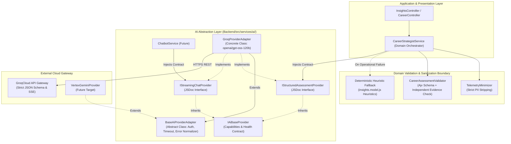
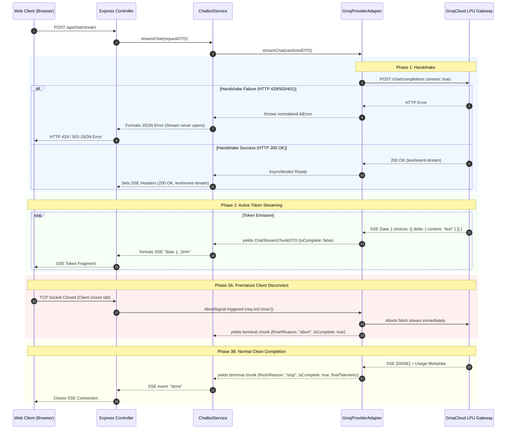
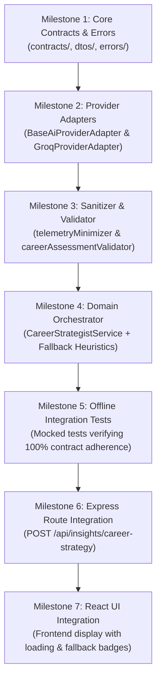

# Stage 2A.15 — Provider Abstraction Contract Refinement & Final Sign-Off Specification

**Project:** Evolexa Career Strategist / Job Tracker  
**Role:** Senior Backend Architect & AI Integration Engineer  
**Execution Mode:** STRICTLY READ-ONLY (No Code Changes, No Live Inference)  
**Previous Stages:** Stage 2A.12 (Provider Selection), Stage 2A.14 (Abstraction Extraction)  
**Date:** November 5, 2026  
**Status:** COMPLETE — REFINED CONTRACT SPECIFICATION PREPARED FOR STAGE 2B APPROVAL  

---

## Executive Summary

Stage 2A.15 refines the provider abstraction contract formulated in Stage 2A.14 to resolve critical operational, security, error-handling, streaming, and validation boundaries.

This specification establishes the **final, implementation-ready contract** for the Evolexa AI subsystem (`Backend/src/services/ai/`) prior to authorizing Stage 2B production integration.



### Approved Core Principles Retained:
1. **Option C Architecture:** Base provider contract (`IAiBaseProvider`) with capability-specific extensions (`IStructuredAssessmentProvider`, `IStreamingChatProvider`).
2. **Groq Primary Candidate:** `openai/gpt-oss-120b` via GroqCloud selected as the primary operational engine for Phase 2.
3. **Strict Abstraction Isolation:** Application controllers and domain services depend 100% on abstract contracts, never on provider SDKs.
4. **No Adapter-Level Fallback:** Provider adapters must **never** implement silent heuristic fallback. Fallback belongs strictly in the domain orchestration service (`CareerStrategistService`).

---

## 1. Interface & Adapter Architecture

### 1.1 JSDoc Structural Contracts vs. Concrete JavaScript Classes

Because Evolexa's backend runtime is **Node.js with CommonJS (`type: "commonjs"`)**, pure interfaces cannot exist as runtime JavaScript keywords.

To achieve strict architectural rigor without runtime overhead:
- **Contracts (`contracts/`)** are defined as JSDoc `@typedef` and `@interface` declarations. They define structural conformance (duck typing) verified by IDEs and TypeScript/JSDoc compilers.
- **Base Adapter (`BaseAiProviderAdapter`)** is an abstract concrete class providing shared utilities (credential protection, timeout management, normalized error transformation).
- **Concrete Provider Adapter (`GroqProviderAdapter`)** extends `BaseAiProviderAdapter` and satisfies both `@implements {IStructuredAssessmentProvider}` and `@implements {IStreamingChatProvider}`.

### 1.2 Shared `BaseAiProviderAdapter` Class

JavaScript does not support multiple class inheritance. The base class provides universal mechanics without restricting capability-specific method implementations:

```javascript
/**
 * @abstract
 * Base provider adapter implementing shared connection, timeout, and error mechanics.
 */
class BaseAiProviderAdapter {
  /**
   * @param {Object} options
   * @param {string} options.providerId - e.g. "groq"
   * @param {string} options.modelIdentifier - e.g. "openai/gpt-oss-120b"
   * @param {string} options.apiKey - Configured credential
   * @param {number} [options.timeoutMs=15000] - Default execution timeout boundary
   */
  constructor({ providerId, modelIdentifier, apiKey, timeoutMs = 15000 }) {
    if (new.target === BaseAiProviderAdapter) {
      throw new TypeError("Cannot instantiate abstract class BaseAiProviderAdapter directly");
    }
    this._providerId = providerId;
    this._modelIdentifier = modelIdentifier;
    this._apiKey = apiKey || null;
    this._timeoutMs = timeoutMs;
  }

  get providerId() { return this._providerId; }
  get modelIdentifier() { return this._modelIdentifier; }

  /**
   * Protected credential status indicator. NEVER returns key characters or prefixes.
   * @returns {string|null}
   */
  getMaskedKey() {
    if (!this._apiKey || this._apiKey.trim().length === 0) return null;
    return "[CONFIGURED_PROTECTED]";
  }

  /**
   * Wraps an asynchronous operation with an AbortSignal timeout and cancellation listener.
   *
   * @protected
   * @template T
   * @param {(signal: AbortSignal) => Promise<T>} executeFn
   * @param {Object} [options]
   * @param {number} [options.timeoutMs]
   * @param {AbortSignal} [options.callerSignal]
   * @returns {Promise<T>}
   */
  async _withExecutionBoundary(executeFn, { timeoutMs = this._timeoutMs, callerSignal = null } = {}) {
    const controller = new AbortController();
    let timeoutFired = false;

    const timeoutId = setTimeout(() => {
      timeoutFired = true;
      controller.abort("TIMEOUT_EXCEEDED");
    }, timeoutMs);

    // Relay caller cancellation (e.g. client disconnect)
    if (callerSignal) {
      if (callerSignal.aborted) {
        clearTimeout(timeoutId);
        controller.abort("CALLER_CANCELLED");
      } else {
        callerSignal.addEventListener("abort", () => {
          clearTimeout(timeoutId);
          controller.abort("CALLER_CANCELLED");
        }, { once: true });
      }
    }

    try {
      return await executeFn(controller.signal);
    } catch (err) {
      if (controller.signal.aborted) {
        if (timeoutFired) {
          throw new AiTimeoutError(`Request timed out after ${timeoutMs}ms`, {
            providerId: this.providerId,
            timeoutMs,
            originalError: err,
          });
        }
        throw new AiCancellationError("Request cancelled by caller", {
          providerId: this.providerId,
          originalError: err,
        });
      }
      throw err;
    } finally {
      clearTimeout(timeoutId);
    }
  }

  /**
   * Capabilities exposed by the provider instance.
   * @abstract
   * @returns {ProviderCapabilities}
   */
  get capabilities() {
    throw new Error("Getter 'capabilities' must be implemented by subclass");
  }
}
```

### 1.3 Minimal Base Contract (`IAiBaseProvider`)

The base interface avoids extraneous methods, exposing only identity, capabilities, and non-generating health verification:

```javascript
/**
 * @typedef {Object} ProviderCapabilities
 * @property {boolean} structuredAssessment - Native JSON Schema decoding support.
 * @property {boolean} streamingChat - Server-Sent Events conversational token streaming.
 * @property {boolean} nativeThinking - Model utilizes internal chain-of-thought tokens.
 */

/**
 * @typedef {Object} EndpointAccessibilityCheck
 * @property {boolean} isAccessible - True if network handshake succeeded and credentials were authorized.
 * @property {string} providerId - "groq" | "gemini_vertex"
 * @property {string} modelIdentifier - Target model ID
 * @property {number} latencyMs - Round-trip ping latency
 * @property {string|null} error - Error description if inaccessible
 */

/**
 * @interface IAiBaseProvider
 */
class IAiBaseProvider {
  /** @returns {string} */
  get providerId() { throw new Error("Not implemented"); }

  /** @returns {string} */
  get modelIdentifier() { throw new Error("Not implemented"); }

  /** @returns {ProviderCapabilities} */
  get capabilities() { throw new Error("Not implemented"); }

  /**
   * Verifies API credentials and catalog availability without consuming generation quota.
   * @returns {Promise<EndpointAccessibilityCheck>}
   */
  async verifyAccessibility() { throw new Error("Not implemented"); }
}
```

---

## 2. Refined Contracts & DTOs

### 2.1 Workload A: Structured Career Assessment (`IStructuredAssessmentProvider`)

```javascript
/**
 * @interface IStructuredAssessmentProvider
 * @extends IAiBaseProvider
 */
class IStructuredAssessmentProvider extends IAiBaseProvider {
  /**
   * Executes structured career assessment.
   *
   * @param {CareerAssessmentRequestDTO} request - Sanitized telemetry input DTO.
   * @returns {Promise<RawProviderAssessmentOutput>} - Raw parsed payload + telemetry.
   *   (Note: Domain schema validation is owned by CareerAssessmentValidator, NOT the adapter).
   * @throws {AiError} Normalized domain error.
   */
  async generateAssessment(request) { throw new Error("Not implemented"); }
}
```

#### Refined Request DTO (`CareerAssessmentRequestDTO`):
```javascript
/**
 * @typedef {Object} CareerAssessmentRequestDTO
 * @property {string} correlationId - Unique tracing UUID.
 * @property {Object} candidateProfile
 * @property {string} candidateProfile.headline - Professional headline (max 120 chars).
 * @property {number} candidateProfile.yearsOfExperience - Verified numerical years.
 * @property {string[]} candidateProfile.declaredSkills - Verified candidate technical skills.
 * @property {string[]} candidateProfile.targetRoles - Aspirational job titles (max 5).
 * @property {string|null} [candidateProfile.userNotes] - Sanitized commentary (max 1000 chars, no HTML/control chars).
 * @property {Object} pipelineTelemetry
 * @property {number} pipelineTelemetry.trackedOpportunities - Total jobs in tracker.
 * @property {number} pipelineTelemetry.submittedApplications - Submitted applications (non-saved).
 * @property {number} pipelineTelemetry.savedCount - Bookmarked opportunities.
 * @property {number} pipelineTelemetry.activeInPipeline - Active in Applied/OA/Interview.
 * @property {number} pipelineTelemetry.interviewsInProgress - Active interview rounds.
 * @property {number} pipelineTelemetry.pendingOffers - Active offers.
 * @property {number} pipelineTelemetry.cumulativeOffers - Historical offers.
 * @property {number} pipelineTelemetry.cumulativeRejections - Historical rejections.
 * @property {Array<{ status: string, count: number }>} pipelineTelemetry.stageDistribution
 * @property {Object} pipelineTelemetry.staleAlerts
 * @property {number} pipelineTelemetry.staleAlerts.staleCount - Dormant applications (>threshold).
 * @property {number} pipelineTelemetry.staleAlerts.thresholdDays - Inactivity threshold days.
 * @property {Object} [options]
 * @property {number} [options.timeoutMs=15000] - Hard execution boundary.
 * @property {AbortSignal} [options.signal] - Cancellation signal.
 */
```

#### Raw Adapter Output vs. Final Validated DTO:
To strictly separate transport from domain validation:
- **`GroqProviderAdapter`** returns `RawProviderAssessmentOutput`:
  ```javascript
  /**
   * @typedef {Object} RawProviderAssessmentOutput
   * @property {Object} rawData - Parsed JSON object from model.
   * @property {ProviderTelemetryMetadata} telemetry - Token usage, latency, and rate limits.
   */
  ```
- **`CareerAssessmentValidator`** audits `rawData` against `CAREER_ASSESSMENT_JSON_SCHEMA` and executes independent anti-hallucination checks, producing the final **`CareerAssessmentResponseDTO`**:
  ```javascript
  /**
   * @typedef {Object} CareerAssessmentResponseDTO
   * @property {boolean} success - True if model generation and validation passed.
   * @property {string} correlationId - Tracing identifier.
   * @property {AssessmentDataPayload} assessment - Validated career strategy diagnostic.
   * @property {ValidationAuditMetadata} validationAudit - Results of independent validation.
   * @property {ProviderTelemetryMetadata} telemetry - Telemetry metrics.
   */
  ```

---

### 2.2 Workload B: Conversational Streaming (`IStreamingChatProvider`)

```javascript
/**
 * @interface IStreamingChatProvider
 * @extends IAiBaseProvider
 */
class IStreamingChatProvider extends IAiBaseProvider {
  /**
   * Opens conversational token stream.
   *
   * @param {ChatStreamRequestDTO} request
   * @returns {AsyncIterable<ChatStreamChunkDTO>}
   * @throws {AiError} Normalized error if handshake fails.
   */
  async *streamChat(request) { throw new Error("Not implemented"); }
}
```

#### Stream Lifecycle & Chunk DTO:
```javascript
/**
 * @typedef {Object} ChatStreamChunkDTO
 * @property {string} correlationId - Tracing identifier.
 * @property {number} sequenceIndex - Monotonically increasing chunk counter (0, 1, 2...).
 * @property {string} deltaText - Text fragment emitted in this turn.
 * @property {boolean} isComplete - True ONLY on final terminal chunk.
 * @property {"stop"|"length"|"abort"|"error"|null} finishReason - Termination reason.
 * @property {ProviderTelemetryMetadata|null} finalTelemetry - Present ONLY on terminal chunk.
 * @property {string|null} [errorMessage] - Present if finishReason === "error".
 */
```

---

## 3. Streaming Lifecycle Contract

Streaming over HTTP Server-Sent Events (SSE) introduces complex asynchronous failure modes. The streaming lifecycle must enforce deterministic behavior across all phases:



### Deterministic Streaming Rules:
1. **Initial Handshake Failures:** If the provider returns HTTP 4xx/5xx before the stream headers are established, the adapter **throws a normalized `AiError`**. The Express controller catches this and returns a standard JSON error response (`503`/`429`), preventing an empty broken SSE stream.
2. **Mid-Stream Provider Drop:** If the provider connection drops after tokens have started streaming, the async iterator catches the network failure, emits **exactly one terminal chunk** with `isComplete: true, finishReason: "error", errorMessage: "Stream interrupted by upstream provider"`, and cleanly terminates.
3. **Client Disconnects:** The Express controller hooks `req.on('close')` to trigger the `AbortSignal`. The adapter listens to this signal, immediately calls `reader.cancel()`, and halts background consumption, preventing phantom token billing.
4. **Duplicate Completion Guard:** The adapter maintains an internal `hasTerminated` boolean flag. Once a terminal chunk (`isComplete: true`) is yielded, the generator returns immediately, guaranteeing zero duplicate completion events.

---

## 4. Error Precedence, Retry & Circuit Breaker Architecture

### 4.1 Deterministic Error Precedence

When overlapping failure conditions occur (e.g. an abort signal triggers while reading a network error), the adapter must classify the error using strict deterministic precedence:

```
┌───────┬───────────────────────────────┬────────────────────────────┬─────────────┬──────────────┐
│ Order │ Condition Detected            │ Classification Class       │ HTTP Status │ Retryable?   │
├───────┼───────────────────────────────┼────────────────────────────┼─────────────┼──────────────┤
│ 1     │ Caller AbortSignal fired      │ `AiCancellationError`      │ 499         │ NO           │
│       │ (without timeout trigger)     │                            │             │              │
├───────┼───────────────────────────────┼────────────────────────────┼─────────────┼──────────────┤
│ 2     │ 15,000ms wall-clock expired   │ `AiTimeoutError`           │ 504         │ NO           │
├───────┼───────────────────────────────┼────────────────────────────┼─────────────┼──────────────┤
│ 3     │ HTTP 401 or 403               │ `AiAuthenticationError`    │ 401 / 403   │ NO           │
├───────┼───────────────────────────────┼────────────────────────────┼─────────────┼──────────────┤
│ 4     │ HTTP 400                      │ `AiConfigurationError`     │ 400         │ NO           │
├───────┼───────────────────────────────┼────────────────────────────┼─────────────┼──────────────┤
│ 5     │ HTTP 429 (Daily/RPD/Credit)   │ `AiQuotaExhaustedError`    │ 429         │ NO           │
├───────┼───────────────────────────────┼────────────────────────────┼─────────────┼──────────────┤
│ 6     │ HTTP 429 (RPM / TPM window)   │ `AiRateLimitError`         │ 429         │ NO           │
├───────┼───────────────────────────────┼────────────────────────────┼─────────────┼──────────────┤
│ 7     │ HTTP 503 (Overloaded/Demand)  │ `AiCapacityError`          │ 503         │ YES (Max 2)  │
├───────┼───────────────────────────────┼────────────────────────────┼─────────────┼──────────────┤
│ 8     │ HTTP 502 (Bad Gateway/Proxy)  │ `AiBadGatewayError`        │ 502         │ YES (Max 1)  │
├───────┼───────────────────────────────┼────────────────────────────┼─────────────┼──────────────┤
│ 9     │ HTTP 504 (Gateway Timeout)    │ `AiGatewayTimeoutError`    │ 504         │ NO           │
├───────┼───────────────────────────────┼────────────────────────────┼─────────────┼──────────────┤
│ 10    │ TCP/TLS connection drop / DNS │ `AiNetworkError`           │ 502         │ YES (Max 1)  │
├───────┼───────────────────────────────┼────────────────────────────┼─────────────┼──────────────┤
│ 11    │ Non-JSON payload / malformed  │ `AiModelFailureError`      │ 502         │ NO           │
└───────┴───────────────────────────────┴────────────────────────────┴─────────────┴──────────────┘
```

### 4.2 Non-Idempotent Retry Safety

> [!CAUTION]
> **Retry Safety Rule:**  
> Large Language Model inference calls are **non-idempotent** from a cost and server-load perspective.
> - If an `AiTimeoutError` occurs, the provider gateway may still be generating tokens in the background. Re-issuing the request doubles token consumption and exacerbates rate limits.
> - Therefore, **timeouts and model errors MUST NEVER be automatically retried**.
> - Retries are restricted strictly to:
>   1. Early network connection drops occurring before HTTP payload transmission.
>   2. Explicit HTTP 503 Capacity Unavailable responses where a `Retry-After` header confirms the request was rejected prior to model dispatch.

### 4.3 Circuit Breaker Governance

To prevent thrashing during outages, a stateful Circuit Breaker pattern is managed in the domain service layer:

```
         ┌─────────────────────────┐
         │         CLOSED          │ (Normal Operation)
         │  (All requests proceed) │
         └────────────┬────────────┘
                      │
   Consecutive 503 / 502 / Network Errors >= 3
                      │
                      ▼
         ┌─────────────────────────┐
         │          OPEN           │ (Fails Fast / Direct Fallback)
         │  (Rejects immediately;  │
         │   Cooldown: 60 seconds) │
         └────────────┬────────────┘
                      │
             Cooldown expires
                      │
                      ▼
         ┌─────────────────────────┐
         │        HALF-OPEN        │ (Probes Provider)
         │  (Dispatches 1 probe)   │
         └───────┬─────────┬───────┘
                 │         │
          Probe Fails   Probe Succeeds
                 │         │
                 ▼         ▼
             Back to     Back to
              OPEN       CLOSED
```

- **Authentication (401/403) and Configuration (400) Errors DO NOT trip the circuit breaker.** These represent developer credential or parameter defects. Tripping the circuit breaker would obscure the bug behind a generic "provider outage" status.
- **Quota Exhaustion (429 Daily):** Transitions into a dedicated `QUOTA_EXHAUSTED` state that silences requests for the duration of the provider reset window (up to 24 hours), avoiding useless network dispatches.

---

## 5. Privacy, Security & Anti-Hallucination Governance

### 5.1 Privacy & Redaction Contract

1. **Zero Credential Exposure:** Adapter `getMaskedKey()` returns strictly `"[CONFIGURED_PROTECTED]"` or `null`. No prefix (`gsk_...`) or suffix (`...3f8a`) may appear in application logs or exception stack traces.
2. **Telemetry Redaction:** Candidate names, emails, phone numbers, locations, and raw resume files are **completely stripped** by `TelemetryMinimizer` before any payload leaves the server. Telemetry objects store only anonymized numerical metrics and tracing UUIDs.
3. **Delimiter Vulnerability Boundary:** XML delimiters (`<untrusted_user_notes>`) provide contextual separation for the LLM, but **are NOT treated as a security boundary**. Freeform text must be bounded to 1,000 characters with all HTML/XML tags and control characters stripped prior to insertion.

### 5.2 Independent Evidence Validation (Anti-Hallucination)

> [!WARNING]
> **Validation Mandate:**  
> **NEVER trust model-generated claims of compliance!**  
> In testing, LLMs hallucinating external skills frequently output `"hallucinationCheckPassed": true`. The model cannot be trusted to self-audit.

The `CareerAssessmentValidator` enforces **independent deterministic verification**:
```javascript
// Inside CareerAssessmentValidator.js:
function auditEvidenceGrounding(assessment, candidateProfile) {
  const verifiedSkills = new Set(candidateProfile.declaredSkills.map(s => s.toLowerCase()));
  const claimedSkills = assessment.skillGapAnalysis.verifiedCandidateSkills || [];

  // Deterministically audit that all claimed verified skills exist in candidate profile
  const hallucinatedSkills = claimedSkills.filter(s => !verifiedSkills.has(s.toLowerCase()));

  if (hallucinatedSkills.length > 0) {
    return {
      passed: false,
      error: `Model hallucinated unverified skills: ${hallucinatedSkills.join(", ")}`,
      hallucinatedSkills,
    };
  }

  return { passed: true, error: null };
}
```

---

## 6. Response Validation Ownership & Layering

Responsibility for processing model output is strictly divided across three architectural tiers:

```
┌─────────────────────────────────┬──────────────────────────────────────────────────────────────────┐
│ Architectural Layer             │ Responsibilities & Validation Ownership                          │
├─────────────────────────────────┼──────────────────────────────────────────────────────────────────┤
│ 1. Provider Adapter             │ • Executes HTTP transport with timeout boundary.                 │
│    (`GroqProviderAdapter`)      │ • Parses raw HTTP response into JSON (`JSON.parse`).             │
│                                 │ • Normalizes HTTP errors into domain `AiError` classes.          │
│                                 │ • Extracts rate-limit and token usage telemetry.                 │
│                                 │ • Returns `{ rawData: Object, telemetry: Object }`.              │
│                                 │ • DOES NOT validate domain JSON schema or candidate evidence.    │
├─────────────────────────────────┼──────────────────────────────────────────────────────────────────┤
│ 2. Domain Validator             │ • Validates structural conformance via Ajv JSON Schema validator │
│    (`CareerAssessmentValidator`)│   against `CAREER_ASSESSMENT_JSON_SCHEMA`.                       │
│                                 │ • Enforces enum bounds (`careerStage`, `pipelineHealth`).        │
│                                 │ • Executes deterministic skill-grounding audit.                  │
│                                 │ • Throws `AiSchemaValidationError` if payload is invalid.        │
├─────────────────────────────────┼──────────────────────────────────────────────────────────────────┤
│ 3. Domain Orchestrator          │ • Calls `TelemetryMinimizer` to strip PII.                       │
│    (`CareerStrategistService`)  │ • Dispatches request to `IStructuredAssessmentProvider`.         │
│                                 │ • Invokes `CareerAssessmentValidator`.                           │
│                                 │ • Intercepts operational errors and executes fallback pipeline.  │
│                                 │ • Constructs and returns final `CareerAssessmentResponseDTO`.    │
└─────────────────────────────────┴──────────────────────────────────────────────────────────────────┘
```

---

## 7. Fallback Governance & Observability

### 7.1 Permitted vs. Forbidden Fallback Errors

```
┌──────────────────────────────────────┬──────────────────┬──────────────────────────────────────────┐
│ Normalized Error Class               │ Fallback Status  │ Architectural Action                     │
├──────────────────────────────────────┼──────────────────┼──────────────────────────────────────────┤
│ `AiRateLimitError` (429 TPM/RPM)     │ PERMITTED        │ Execute deterministic pipeline heuristics│
│ `AiQuotaExhaustedError` (429 Daily)  │ PERMITTED        │ Execute deterministic pipeline heuristics│
│ `AiCapacityError` (503 Overloaded)   │ PERMITTED        │ Execute deterministic pipeline heuristics│
│ `AiTimeoutError` (504 Timeout)       │ PERMITTED        │ Execute deterministic pipeline heuristics│
│ `AiNetworkError` (Connection Drop)   │ PERMITTED        │ Execute deterministic pipeline heuristics│
│ `AiAuthenticationError` (401/403)    │ STRICTLY FORBIDDEN│ THROW / PROPAGATE (Config/Security defect)│
│ `AiConfigurationError` (400)         │ STRICTLY FORBIDDEN│ THROW / PROPAGATE (Code/Parameter defect)│
│ `AiSchemaValidationError` (422)      │ STRICTLY FORBIDDEN│ THROW / PROPAGATE (Prompt/Schema defect) │
└──────────────────────────────────────┴──────────────────┴──────────────────────────────────────────┘
```

### 7.2 Explicit Fallback Metadata & Telemetry Segregation

When a permitted error triggers fallback, the response must clearly identify itself to the client and monitoring systems:

```json
{
  "success": true,
  "correlationId": "c8a14f2e-4b21-4f81-8b32-9c1f4e5a6b7c",
  "fallbackActive": true,
  "fallbackMetadata": {
    "reason": "AI inference gateway temporarily unavailable (HTTP 429 Rate Limit)",
    "strategy": "deterministic_pipeline_heuristics",
    "ruleEngineVersion": "2.1.0"
  },
  "assessment": {
    "candidateSummary": {
      "careerStage": "entry_level",
      "pipelineHealth": "needs_focus",
      "primaryBottleneck": "High volume of saved jobs with low application velocity"
    },
    ...
  },
  "telemetry": {
    "providerId": "fallback_heuristic",
    "modelIdentifier": "none",
    "latencyMs": 42,
    "tokenUsage": { "promptTokens": 0, "completionTokens": 0, "totalTokens": 0 }
  }
}
```

*Telemetry Rule:* Fallback invocations record `providerId: "fallback_heuristic"`. Monitoring dashboards must **never** count fallback executions as AI provider successes, preserving observability integrity.

---

## 8. Health & Observability Verification Tiers

To eliminate ambiguities regarding health checks and quota consumption:

```
┌─────────┬──────────────────────────┬─────────────────────────────┬─────────────────┬─────────────────────┐
│ Tier    │ Check Type               │ Target Inspected            │ Quota Consumed? │ Verification Timing │
├─────────┼──────────────────────────┼─────────────────────────────┼─────────────────┼─────────────────────┤
│ Tier 1  │ Configuration Health     │ Local env vars (`API_KEY`)  │ 0 Quota         │ App boot / startup  │
│ Tier 2  │ Endpoint Accessibility   │ `GET /models` ping          │ 0 Quota         │ Readiness probe     │
│ Tier 3  │ Live Generation Audit    │ 1-token live completion     │ 1 Request       │ Manual / Deep Audit │
└─────────┴──────────────────────────┴─────────────────────────────┴─────────────────┴─────────────────────┘
```

- **Health Check Boundary:** Routine Kubernetes or Docker health probes must **only call Tier 1 or Tier 2**. Calling Tier 3 on a periodic polling loop would exhaust daily free-tier quotas within hours.

---

## 9. Final Proposed Directory Structure (`Backend/src/services/ai/`)

```text
Backend/src/services/ai/
├── contracts/
│   ├── IAiBaseProvider.js                   # JSDoc interface for base health & metadata
│   ├── IStructuredAssessmentProvider.js     # JSDoc interface for structured career assessment
│   ├── IStreamingChatProvider.js            # JSDoc interface for conversational streaming
│   ├── dtos/
│   │   ├── CareerAssessmentRequest.dto.js   # Grounded input telemetry DTO
│   │   ├── CareerAssessmentResponse.dto.js  # Final validated response DTO
│   │   ├── ChatStreamRequest.dto.js         # Streaming chat input DTO
│   │   └── ChatStreamChunk.dto.js           # Streaming chunk DTO
│   └── errors/
│       ├── AiError.js                       # Base error class
│       ├── AiAuthenticationError.js         # 401/403 Invalid API key
│       ├── AiRateLimitError.js              # 429 RPM/TPM limit
│       ├── AiQuotaExhaustedError.js         # 429 Daily/Credit limit
│       ├── AiCapacityError.js               # 503 Overloaded
│       ├── AiBadGatewayError.js             # 502 Bad Gateway
│       ├── AiGatewayTimeoutError.js         # 504 Gateway Timeout
│       ├── AiTimeoutError.js                # 15s execution timeout boundary
│       ├── AiCancellationError.js           # 499 Caller cancelled
│       ├── AiNetworkError.js                # Socket / DNS transport failure
│       ├── AiModelFailureError.js           # Malformed non-JSON / empty completion
│       ├── AiSchemaValidationError.js       # JSON schema / DTO failure
│       └── AiConfigurationError.js          # Bad parameters / missing env vars
├── providers/
│   ├── BaseAiProviderAdapter.js             # Abstract class: timeouts, masking, error normalization
│   ├── groq/
│   │   ├── GroqProviderAdapter.js           # Implements IStructuredAssessment & IStreamingChat
│   │   └── groqRateLimitParser.js           # Isolated header parsing helper
│   └── gemini/                              # Reserved for future Google Cloud Vertex AI
├── sanitizers/
│   └── telemetryMinimizer.js                # Strict PII stripping & input bound enforcement
├── validators/
│   └── careerAssessmentValidator.js         # Ajv schema validation & independent skill audit
├── circuitBreaker/
│   └── ProviderCircuitBreaker.js            # Stateful circuit breaker (Closed/Open/Half-Open)
└── CareerStrategistService.js               # Domain orchestrator with fallback execution
```

---

## 10. Stage 2B Implementation Sequence

Upon formal authorization, Stage 2B must be executed in seven sequential, independently verifiable milestones:



---

## 11. Completion Confirmation & Inspected Files

### Exact Files Inspected:
- `Backend/poc/STAGE_2A14_PROVIDER_ABSTRACTION_CONTRACT_REVIEW.md` (Stage 2A.14 extracted contract)
- `Backend/poc/AI_PROVIDER_SELECTION_AND_ARCHITECTURE_ASSESSMENT.md` (Stage 2A.12 blueprint)
- `Backend/poc/groq/groqClient.js` (Groq client mechanics, retry boundaries, error classification)
- `Backend/poc/groq/responseSchema.js` (JSON Schema specification & validation)
- `Backend/poc/groq/promptBuilder.js` (Prompt assembly & telemetry minimization)
- `Backend/src/models/files/insights.model.js` (Database telemetry extraction queries)
- `Backend/src/models/files/profile.model.js` (Profile data fields & privacy settings)
- `Backend/package.json` (Runtime dependencies and environment)

### Confirmation of Mandatory Restrictions:
- **Source Code Modifications:** ZERO (No production files created or modified).
- **Interface Implementation:** ZERO (No classes or interfaces implemented in production).
- **Live API Requests:** ZERO (No network requests, zero quota consumed).
- **Billing / Provider Changes:** ZERO.

*Stage 2A.15 is complete. Awaiting project-owner review and formal authorization for Stage 2B.*
