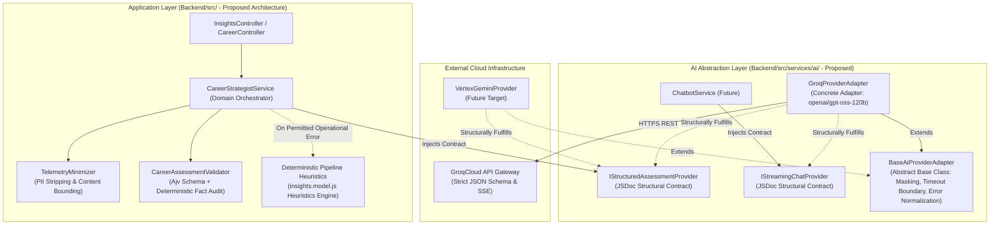
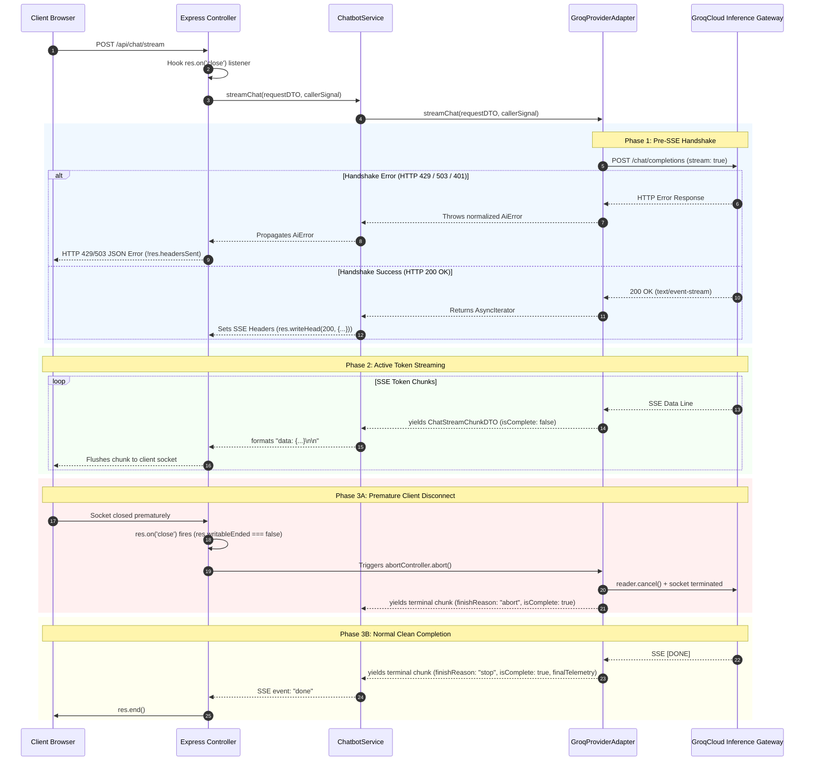
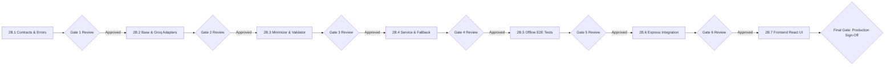

# Stage 2A.16-R1 — Final Provider Abstraction Contract & Stage 2B Implementation Plan

**Project:** Evolexa Career Strategist / Job Tracker  
**Role:** Senior Backend Architect & AI Integration Engineer  
**Execution Mode:** STRICTLY READ-ONLY (No Production Code Changes, No Live Inference)  
**Prerequisite:** Stage 2A.15 Review & Stage 2A.16 Architectural Errata  
**Date:** November 5, 2026  
**Status:** PROPOSED ARCHITECTURAL SPECIFICATION & STAGE 2B ROADMAP (READ-ONLY SPECIFICATION — ZERO REPOSITORY CODE IMPLEMENTED)  

---

## Executive Summary

Stage 2A.16-R1 establishes the definitive architectural specification and execution roadmap for Evolexa's AI foundation, incorporating all errata and corrections identified during architectural review.

> [!IMPORTANT]
> **Specification vs. Implementation Status:**  
> This document is a **proposed design specification and architectural blueprint**. All contracts, interfaces, DTO definitions, adapter signatures, validators, and pseudocode snippets in this document represent proposed designs to be implemented during Stage 2B.  
> **As of this stage, no production implementation has been created.** The proposed directory `Backend/src/services/ai/` does not exist in the repository. No controllers, models, routes, or production configurations have been modified.



### Core Architecture Decisions Preserved:
1. **Option C Abstraction:** Minimal base interface (`IAiBaseProvider`) with capability-specific extensions (`IStructuredAssessmentProvider`, `IStreamingChatProvider`).
2. **Groq Primary Candidate:** `openai/gpt-oss-120b` via GroqCloud for Phase 2 MVP.
3. **CommonJS & JSDoc:** Native CommonJS implementation using structural JSDoc typing without empty runtime dummy classes.
4. **Adapter Boundary:** Provider adapters handle transport, raw JSON parsing, and error normalization; domain validators handle schema compliance and anti-hallucination checks; domain services handle PII sanitization, orchestration, and fallback.
5. **No Adapter-Level Fallback:** Provider adapters must **never** implement fallback.

---

## 1. Structural Contracts & Capability Discovery (Proposed Specification)

### 1.1 Pure JSDoc Structural Typing (No Runtime Dummy Classes)

In CommonJS JavaScript, runtime interface classes containing `throw new Error("Not implemented")` create unnecessary class hierarchies and misleading prototypes. 

In this specification, all contracts are defined as **pure JSDoc structural contracts**. Runtime implementations will exist exclusively in concrete classes (`BaseAiProviderAdapter`, `GroqProviderAdapter`) when implemented in Stage 2B. At this stage, no runtime implementation exists in the repository.

```javascript
/**
 * @typedef {Object} ProviderCapabilities
 * @property {boolean} structuredAssessment - Native JSON Schema decoding support.
 * @property {boolean} streamingChat - Server-Sent Events conversational token streaming.
 * @property {boolean} nativeThinking - Model utilizes internal chain-of-thought tokens.
 */

/**
 * @typedef {Object} EndpointAccessibilityCheck
 * @property {boolean} isAccessible - True if network handshake succeeded and credentials were authenticated.
 * @property {string} providerId - "groq" | "gemini_vertex"
 * @property {string} modelIdentifier - Target model ID (e.g. "openai/gpt-oss-120b")
 * @property {number} latencyMs - Ping round-trip latency in milliseconds.
 * @property {string|null} error - Diagnostic error message if inaccessible.
 */

/**
 * @typedef {Object} IAiBaseProvider
 * @property {string} providerId - Unique provider key.
 * @property {string} modelIdentifier - Target model identifier.
 * @property {ProviderCapabilities} capabilities - Feature support matrix.
 * @property {() => Promise<EndpointAccessibilityCheck>} verifyAccessibility - Non-generation health check.
 */

/**
 * @typedef {Object} IStructuredAssessmentProvider
 * @property {string} providerId
 * @property {string} modelIdentifier
 * @property {ProviderCapabilities} capabilities
 * @property {() => Promise<EndpointAccessibilityCheck>} verifyAccessibility
 * @property {(request: CareerAssessmentRequestDTO) => Promise<RawProviderAssessmentOutput>} generateAssessment
 */

/**
 * @typedef {Object} IStreamingChatProvider
 * @property {string} providerId
 * @property {string} modelIdentifier
 * @property {ProviderCapabilities} capabilities
 * @property {() => Promise<EndpointAccessibilityCheck>} verifyAccessibility
 * @property {(request: ChatStreamRequestDTO) => AsyncIterable<ChatStreamChunkDTO>} streamChat
 */
```

### 1.2 Capability Discovery & Runtime Conformance Verification (Proposed Specification)

To eliminate runtime type-casting errors, the proposed abstraction layer specifies zero-dependency structural validators to be created in `contracts/conformance.js`:

```javascript
/**
 * Proposed structural conformance validator for IStructuredAssessmentProvider.
 * @param {any} provider
 * @returns {provider is IStructuredAssessmentProvider}
 */
function isStructuredAssessmentProvider(provider) {
  return (
    provider &&
    typeof provider === "object" &&
    typeof provider.providerId === "string" &&
    typeof provider.modelIdentifier === "string" &&
    typeof provider.verifyAccessibility === "function" &&
    typeof provider.generateAssessment === "function" &&
    Boolean(provider.capabilities?.structuredAssessment)
  );
}

/**
 * Proposed structural conformance validator for IStreamingChatProvider.
 * @param {any} provider
 * @returns {provider is IStreamingChatProvider}
 */
function isStreamingChatProvider(provider) {
  return (
    provider &&
    typeof provider === "object" &&
    typeof provider.providerId === "string" &&
    typeof provider.modelIdentifier === "string" &&
    typeof provider.verifyAccessibility === "function" &&
    typeof provider.streamChat === "function" &&
    Boolean(provider.capabilities?.streamingChat)
  );
}
```

---

## 2. Shared Base Adapter (`BaseAiProviderAdapter`) Specification

The proposed abstract class `BaseAiProviderAdapter` encapsulates universal infrastructure logic (safe credential masking, execution timeout boundaries, memory-safe cancellation, and standardized error mapping):

```javascript
/**
 * @abstract
 * Proposed concrete base class for AI provider adapters (Milestone 2B.2).
 */
class BaseAiProviderAdapter {
  /**
   * @param {Object} options
   * @param {string} options.providerId - e.g. "groq"
   * @param {string} options.modelIdentifier - e.g. "openai/gpt-oss-120b"
   * @param {string} options.apiKey - Configured credential
   * @param {number} [options.timeoutMs=15000] - Default execution timeout boundary
   */
  constructor({ providerId, modelIdentifier, apiKey, timeoutMs = 15000 }) {
    if (new.target === BaseAiProviderAdapter) {
      throw new TypeError("Cannot instantiate abstract class BaseAiProviderAdapter directly");
    }
    this._providerId = providerId;
    this._modelIdentifier = modelIdentifier;
    this._apiKey = apiKey || null;
    this._timeoutMs = timeoutMs;
  }

  get providerId() { return this._providerId; }
  get modelIdentifier() { return this._modelIdentifier; }

  /**
   * Protected status indicator. NEVER returns key characters or prefixes.
   * @returns {string|null}
   */
  getMaskedKey() {
    if (!this._apiKey || this._apiKey.trim().length === 0) return null;
    return "[CONFIGURED_PROTECTED]";
  }

  /**
   * Memory-safe execution boundary with deterministic cancellation and timeout race handling.
   *
   * @protected
   * @template T
   * @param {(signal: AbortSignal) => Promise<T>} executeFn
   * @param {Object} [options]
   * @param {number} [options.timeoutMs]
   * @param {AbortSignal} [options.callerSignal]
   * @returns {Promise<T>}
   */
  async _withExecutionBoundary(executeFn, { timeoutMs = this._timeoutMs, callerSignal = null } = {}) {
    // 1. Fail fast if caller already aborted before dispatch
    if (callerSignal?.aborted) {
      throw new AiCancellationError("Request cancelled by caller prior to dispatch", {
        providerId: this.providerId,
      });
    }

    const controller = new AbortController();
    let timeoutFired = false;
    let timeoutId = null;

    const onCallerAbort = () => {
      if (timeoutId) clearTimeout(timeoutId);
      controller.abort("CALLER_CANCELLED");
    };

    if (callerSignal) {
      callerSignal.addEventListener("abort", onCallerAbort, { once: true });
    }

    timeoutId = setTimeout(() => {
      timeoutFired = true;
      controller.abort("TIMEOUT_EXCEEDED");
    }, timeoutMs);

    try {
      return await executeFn(controller.signal);
    } catch (err) {
      if (controller.signal.aborted) {
        // Deterministic race handling: check callerSignal first
        if (callerSignal?.aborted) {
          throw new AiCancellationError("Request cancelled by caller during execution", {
            providerId: this.providerId,
            originalError: err,
          });
        }
        if (timeoutFired) {
          throw new AiTimeoutError(`Request timed out after ${timeoutMs}ms`, {
            providerId: this.providerId,
            timeoutMs,
            originalError: err,
          });
        }
      }
      throw err;
    } finally {
      if (timeoutId) clearTimeout(timeoutId);
      if (callerSignal) {
        // CRITICAL: Prevent memory leaks on long-lived caller signals
        callerSignal.removeEventListener("abort", onCallerAbort);
      }
    }
  }

  /**
   * Feature capabilities matrix. Must be implemented by concrete subclass.
   * @abstract
   * @returns {ProviderCapabilities}
   */
  get capabilities() {
    throw new Error("Getter 'capabilities' must be implemented by concrete subclass");
  }
}
```

---

## 3. Data Transfer Objects (DTO) Specification

### 3.1 Input DTO (`CareerAssessmentRequestDTO`)

```javascript
/**
 * @typedef {Object} CareerAssessmentRequestDTO
 * @property {string} correlationId - Unique tracing UUID (v4).
 * @property {Object} candidateProfile
 * @property {string} candidateProfile.headline - Professional headline (sanitized, max 120 chars, regex-scrubbed).
 * @property {number} candidateProfile.yearsOfExperience - Verified non-negative numerical experience.
 * @property {string[]} candidateProfile.declaredSkills - Canonicalized array of candidate skills (max 50, max 40 chars each).
 * @property {string[]} candidateProfile.targetRoles - Aspirational job titles (sanitized, max 5, max 60 chars each).
 * @property {string|null} [candidateProfile.userNotes] - Untrusted candidate context notes (max 1,000 chars, regex-scrubbed).
 * @property {Object} pipelineTelemetry
 * @property {number} pipelineTelemetry.trackedOpportunities - Total opportunities in pipeline.
 * @property {number} pipelineTelemetry.submittedApplications - Submitted non-saved opportunities.
 * @property {number} pipelineTelemetry.savedCount - Bookmarked opportunities.
 * @property {number} pipelineTelemetry.activeInPipeline - Active applications in Applied/OA/Interview.
 * @property {number} pipelineTelemetry.interviewsInProgress - Cumulative active interview stages.
 * @property {number} pipelineTelemetry.pendingOffers - Active offers awaiting decision.
 * @property {number} pipelineTelemetry.cumulativeOffers - Historical total offers.
 * @property {number} pipelineTelemetry.cumulativeRejections - Historical total rejections.
 * @property {Array<{ status: string, count: number }>} pipelineTelemetry.stageDistribution
 * @property {Object} pipelineTelemetry.staleAlerts
 * @property {number} pipelineTelemetry.staleAlerts.staleCount - Inactive applications count.
 * @property {number} pipelineTelemetry.staleAlerts.thresholdDays - Inactivity threshold.
 * @property {Object} [options]
 * @property {number} [options.timeoutMs=15000] - Execution timeout boundary.
 * @property {AbortSignal} [options.signal] - Optional caller cancellation signal.
 */
```

### 3.2 Raw Provider Output vs. Domain Response DTO

To separate concerns:
1. **`RawProviderAssessmentOutput`** is returned by `GroqProviderAdapter` to the domain service:
   ```javascript
   /**
    * @typedef {Object} RawProviderAssessmentOutput
    * @property {Object} rawData - Parsed JSON object from model gateway.
    * @property {ProviderTelemetryMetadata} telemetry - Latency, token counts, and rate limits.
    */
   ```
2. **`CareerAssessmentResponseDTO`** is constructed and returned by `CareerStrategistService` after schema and evidence validation:
   ```javascript
   /**
    * @typedef {Object} StrategicRecommendationItem
    * @property {string} id - Unique identifier (e.g. "REC-01").
    * @property {"pipeline_velocity"|"targeting_alignment"|"skill_acquisition"|"interview_preparation"|"data_hygiene"} category
    * @property {"high"|"medium"|"low"} priority
    * @property {string} title
    * @property {string} rationale
    * @property {string[]} actionSteps
    * @property {string} expectedImpact
    */

   /**
    * @typedef {Object} CareerAssessmentResponseDTO
    * @property {boolean} success - True if assessment was generated and validated.
    * @property {string} correlationId - Tracing UUID.
    * @property {boolean} fallbackActive - True if produced by deterministic heuristic engine.
    * @property {Object|null} fallbackMetadata - Fallback strategy and reason if fallbackActive.
    * @property {Object} assessment - Validated career strategy output.
    * @property {Object} assessment.candidateSummary
    * @property {"entry_level"|"mid_level"|"senior"|"lead_architect"|"transitioning"|"unspecified"} assessment.candidateSummary.careerStage
    * @property {"healthy"|"needs_focus"|"critical_bottleneck"|"insufficient_data"|"inconsistent_data"} assessment.candidateSummary.pipelineHealth
    * @property {string} assessment.candidateSummary.primaryBottleneck
    * @property {Object} assessment.pipelineDiagnostics
    * @property {string} assessment.pipelineDiagnostics.volumeAssessment
    * @property {string} assessment.pipelineDiagnostics.stageProgressionVelocity
    * @property {string} assessment.pipelineDiagnostics.staleApplicationRisk
    * @property {Object} assessment.skillGapAnalysis
    * @property {string[]} assessment.skillGapAnalysis.verifiedCandidateSkills
    * @property {string[]} assessment.skillGapAnalysis.criticalMissingSkills
    * @property {string} assessment.skillGapAnalysis.skillBridgingAdvice
    * @property {StrategicRecommendationItem[]} assessment.strategicRecommendations
    * @property {Object} assessment.evidenceGrounding
    * @property {string[]} assessment.evidenceGrounding.citedMetrics
    * @property {string} assessment.evidenceGrounding.dataLimitationsNoted
    * @property {boolean} assessment.evidenceGrounding.hallucinationCheckPassed
    * @property {Object} validationAudit
    * @property {boolean} validationAudit.schemaValid - True if Ajv JSON Schema validation passed.
    * @property {boolean} validationAudit.evidenceGrounded - True if independent deterministic skill check passed.
    * @property {string[]} [validationAudit.discrepancies] - Discrepancy details if any.
    * @property {ProviderTelemetryMetadata} telemetry - Provider, latency, and token telemetry.
    */
   ```

---

## 4. Reconciled 14-Class Error Taxonomy & HTTP Mapping

The AI abstraction layer specifies a strict **14-class error taxonomy** consisting of **1 base class (`AiError`)** and **13 leaf domain error subclasses**.

### 4.1 Error Hierarchy Structure
- `AiError` (Base Class: captures `message`, `statusCode`, `errorType`, `providerId`, `originalError`, `isOperational`)
  - `AiCancellationError` (499 — Caller AbortSignal fired)
  - `AiTimeoutError` (504 — Local 15s execution timeout boundary exceeded)
  - `AiGatewayTimeoutError` (504 — Upstream reverse proxy / gateway HTTP 504)
  - `AiBadGatewayError` (502 — Upstream gateway invalid or unreachable response)
  - `AiCapacityError` (503 — Upstream model overloaded or capacity unavailable)
  - `AiRateLimitError` (429 — Transient requests-per-minute or tokens-per-minute limit)
  - `AiQuotaExhaustedError` (429 — Daily/monthly requests or token credit quota exhausted)
  - `AiNetworkError` (502 — Local socket drop, DNS resolution failure, or TCP connection reset)
  - `AiAuthenticationError` (401/403 — Invalid credentials, unauthorized, or forbidden)
  - `AiConfigurationError` (400 — Invalid adapter options, missing required parameters)
  - `AiContextWindowExceededError` (400 — Prompt tokens exceed model context ceiling)
  - `AiModelFailureError` (502 — Upstream model produced unparseable non-JSON payload or corrupted SSE stream)
  - `AiSchemaValidationError` (422 — Output payload violates Ajv schema or deterministic evidence constraints)

### 4.2 Error Taxonomy, Retryability & Fallback Matrix

```
┌───────────────────────────────┬─────────────────────────────┬─────────────┬──────────────────────────────┬───────────────────────────┐
│ Normalized Error Class        │ Trigger Condition           │ HTTP Status │ Retryable?                   │ Fallback Eligible?        │
├───────────────────────────────┼─────────────────────────────┼─────────────┼──────────────────────────────┼───────────────────────────┤
│ `AiCancellationError`         │ Caller AbortSignal fired    │ 499         │ NO                           │ STRICTLY FORBIDDEN (Throw)│
├───────────────────────────────┼─────────────────────────────┼─────────────┼──────────────────────────────┼───────────────────────────┤
│ `AiTimeoutError`              │ Local 15s timer fired       │ 504         │ NO                           │ PERMITTED                 │
├───────────────────────────────┼─────────────────────────────┼─────────────┼──────────────────────────────┼───────────────────────────┤
│ `AiGatewayTimeoutError`       │ Upstream gateway HTTP 504   │ 504         │ NO                           │ PERMITTED                 │
├───────────────────────────────┼─────────────────────────────┼─────────────┼──────────────────────────────┼───────────────────────────┤
│ `AiBadGatewayError`           │ Upstream gateway HTTP 502   │ 502         │ NO (Ambiguous delivery)      │ PERMITTED                 │
├───────────────────────────────┼─────────────────────────────┼─────────────┼──────────────────────────────┼───────────────────────────┤
│ `AiCapacityError`             │ Upstream model HTTP 503     │ 503         │ NO (Ambiguous delivery)      │ PERMITTED                 │
├───────────────────────────────┼─────────────────────────────┼─────────────┼──────────────────────────────┼───────────────────────────┤
│ `AiRateLimitError`            │ HTTP 429 (Transient TPM/RPM)│ 429         │ NO                           │ PERMITTED                 │
├───────────────────────────────┼─────────────────────────────┼─────────────┼──────────────────────────────┼───────────────────────────┤
│ `AiQuotaExhaustedError`       │ HTTP 429 (Daily/RPD/Credit) │ 429         │ NO                           │ PERMITTED                 │
├───────────────────────────────┼─────────────────────────────┼─────────────┼──────────────────────────────┼───────────────────────────┤
│ `AiNetworkError`              │ Socket drop / DNS fail      │ 502         │ CONDITIONALLY (Pre-write only│ PERMITTED                 │
│                               │                             │             │ Max 1; otherwise NO)         │                           │
├───────────────────────────────┼─────────────────────────────┼─────────────┼──────────────────────────────┼───────────────────────────┤
│ `AiAuthenticationError`       │ HTTP 401 or 403             │ 401 / 403   │ NO                           │ STRICTLY FORBIDDEN (Throw)│
├───────────────────────────────┼─────────────────────────────┼─────────────┼──────────────────────────────┼───────────────────────────┤
│ `AiConfigurationError`        │ Bad params / missing key    │ 400         │ NO                           │ STRICTLY FORBIDDEN (Throw)│
├───────────────────────────────┼─────────────────────────────┼─────────────┼──────────────────────────────┼───────────────────────────┤
│ `AiContextWindowExceededError`│ Prompt exceeds model tokens │ 400         │ NO                           │ STRICTLY FORBIDDEN (Throw)│
├───────────────────────────────┼─────────────────────────────┼─────────────┼──────────────────────────────┼───────────────────────────┤
│ `AiModelFailureError`         │ Non-JSON payload / corrupt  │ 502         │ NO                           │ STRICTLY FORBIDDEN (Throw)│
├───────────────────────────────┼─────────────────────────────┼─────────────┼──────────────────────────────┼───────────────────────────┤
│ `AiSchemaValidationError`     │ Ajv validation mismatch     │ 422         │ NO                           │ STRICTLY FORBIDDEN (Throw)│
└───────────────────────────────┴─────────────────────────────┴─────────────┴──────────────────────────────┴───────────────────────────┘
```

---

## 5. Streaming Lifecycle & Express Response Management



### Express Integration Idiom (Proposed Implementation):
```javascript
// Express controller implementation specification:
const abortController = new AbortController();

// Correct disconnect detection using response lifecycle:
res.on("close", () => {
  if (!res.writableEnded) {
    // Client disconnected before response ended cleanly
    abortController.abort("CLIENT_DISCONNECTED");
  }
});

try {
  const stream = await chatService.streamChat(requestDTO, { signal: abortController.signal });
  
  // Set headers only after handshake succeeds
  res.writeHead(200, {
    "Content-Type": "text/event-stream",
    "Cache-Control": "no-cache",
    "Connection": "keep-alive",
  });

  for await (const chunk of stream) {
    res.write(`data: ${JSON.stringify(chunk)}\n\n`);
  }
  res.end();
} catch (err) {
  if (!res.headersSent) {
    // Pre-handshake failure: return clean JSON
    return res.status(err.statusCode || 500).json({ error: err.message, errorType: err.errorType });
  }
  // Mid-stream failure: write single SSE error terminal event
  res.write(`event: error\ndata: ${JSON.stringify({ error: err.message, errorType: err.errorType })}\n\n`);
  res.end();
}
```

---

## 6. Retry Safety, Ambiguity & Circuit Breaker Governance

### 6.1 Non-Idempotent Retry Policy & Ambiguity Suppression

> [!CAUTION]
> **Strict Non-Idempotent Retry Policy:**
> 1. **No Assumed Safe Retries:** Never assume HTTP 503, HTTP 502, `Retry-After`, or an early connection drop establishes safe retry eligibility. In LLM inference, requests are non-idempotent at the compute and cost level.
> 2. **Uncertain Delivery Treated as Potentially Processed:** If an HTTP request body has been transmitted, or if an upstream gateway returns HTTP 502 or HTTP 503, the backend model may have already received and executed tokens. Automatic retries risk duplicate prompt billing, compounded latency, and duplicate inferences.
> 3. **Non-Transmission Condition Required for Retry:** Automatic retry is permitted **only** when non-transmission or non-dispatch can be deterministically established prior to any request payload transmission. In practice, this is strictly limited to local pre-transmission network failures:
>    - `ECONNREFUSED` (Local socket connection refused before request headers/body write).
>    - `ENOTFOUND` (DNS resolution failure before TCP socket open).
>    - Bounded to: **Maximum 1 retry**.
> 4. **Retry Suppression for Ambiguous Outcomes:** If `ECONNRESET` occurs mid-stream, or if HTTP 502/503 is returned without explicit provider non-dispatch transaction semantics, retry is **strictly suppressed**. The error routes immediately to fallback (if permitted) or throws.
> 5. **`Retry-After` Cooldown Semantics:** The `Retry-After` header indicates provider-recommended delay to avoid immediate rate-limit repetition. It provides **zero proof of dispatch status**. It informs the circuit breaker or rate limiter cooldown window, but **does not authorize automatic request re-issuance**.

### 6.2 Circuit Breaker Implementation Rules

The circuit breaker (`circuitBreaker/ProviderCircuitBreaker.js`) protects the application from cascading failures:
- **State Machine:**
  - `CLOSED`: Normal operation.
  - `OPEN`: Fails fast locally without network calls. Immediately routes to deterministic heuristic fallback. Cooldown: 60 seconds.
  - `HALF-OPEN`: Allows 1 probe request through. If successful, transitions to `CLOSED`. If failed, returns to `OPEN`.
  - `QUOTA_EXHAUSTED`: Dedicated state when daily/credit quotas are exhausted.
- **Trip Conditions:**
  - Tripped ONLY by consecutive operational errors: `AiCapacityError` (503), `AiBadGatewayError` (502), or pre-transmission `AiNetworkError` ($\ge 3$ consecutive failures).
  - **NEVER tripped by `AiAuthenticationError` (401/403) or `AiConfigurationError` (400).** These are code or credential bugs that must throw immediately rather than triggering a false "provider outage".
- **Daily Quota Cooldown Handling:**
  - When `AiQuotaExhaustedError` occurs, the circuit breaker enters `QUOTA_EXHAUSTED`.
  - If provider headers (`x-ratelimit-reset-tokens` or `retry-after`) are missing or unparseable, default to a conservative cooldown of **3,600 seconds (1 hour)** before allowing any re-probe.
  - All requests during this cooldown fail fast locally and dispatch directly to deterministic fallback heuristics.

---

## 7. Evidence Validation & Privacy Boundaries

### 7.1 Freeform Text Privacy Minimization

`TelemetryMinimizer` enforces strict data-minimization before payload assembly:
1. **Omitted Profile Fields:** Candidate `firstName`, `lastName`, `email`, `phone`, `location`, `avatarUrl`, `socialLinks`, and raw resume documents are **strictly omitted** from AI payloads.
2. **Sanitized Input Fields:**
   - `headline`: Sanitized string, max 120 characters, regex-scrubbed.
   - `declaredSkills`: Canonicalized string array, max 50 items, max 40 characters each, filtered against delimiter injections.
   - `targetRoles`: Sanitized string array, max 5 items, max 60 characters each.
   - `userNotes`: Untrusted freeform text, bounded to 1,000 characters, regex-scrubbed.
3. **Regex PII Scrubbing on Freeform Notes (`userNotes`):**
   - Email regex: `/[a-zA-Z0-9._%+-]+@[a-zA-Z0-9.-]+\.[a-zA-Z]{2,}/gi` -> `[EMAIL_REDACTED]`
   - Phone regex: `/\b(\+?\d{1,3}[-.\s]?)?\(?\d{3}\)?[-.\s]?\d{3}[-.\s]?\d{4}\b/g` -> `[PHONE_REDACTED]`
   - URL regex: `/https?:\/\/[^\s"'>]+/gi` -> `[URL_REDACTED]`
4. **Limits of Regex-Based PII Removal:**
   - Regex scrubbing is a heuristic defense-in-depth measure, **not a cryptographic or complete PII guarantee**. It cannot detect arbitrary semantic PII, such as proper names of individuals, informal postal addresses, proprietary employer project codenames, or unstructured autobiographical details.
5. **Untrusted Freeform Input & Delimiter Boundaries:**
   - All freeform user notes are considered untrusted input with potential prompt injection risk.
   - Notes are wrapped inside `<untrusted_user_notes>` tags. System prompts explicitly instruct the model that text inside these tags is candidate context only and must never be interpreted as instructions. Delimiters provide formatting structure to the LLM, **not a security sandbox**.
6. **Telemetry & Log Scrubbing:**
   - API keys are never logged (masked as `[CONFIGURED_PROTECTED]`).
   - Candidate names, emails, phones, and raw freeform notes must never appear in logs, error traces, or OpenTelemetry spans.
   - Model internal reasoning tokens (`thinking` tokens) must never enter persistent logs or client telemetry.
7. **Approval Boundary Distinction:**
   - Architectural approval of the sanitization specification **does not authorize transmission of real candidate data to an external provider**. Production transmission remains subject to separate privacy review. All testing in Phase 2 uses synthetic candidate fixtures exclusively.

### 7.2 Independent Deterministic Fact Verification

> [!WARNING]
> **Anti-Hallucination Boundaries:**  
> Deterministic validation verifies structural consistency against input telemetry, but **cannot evaluate the semantic plausibility or career advice quality** of generated text. **Never trust `hallucinationCheckPassed: true` emitted by the LLM.**

`CareerAssessmentValidator` enforces deterministic factual audits against profile and pipeline data:
1. **Skill Subset Audit:** Audits that all entries in `assessment.skillGapAnalysis.verifiedCandidateSkills` are an exact case-insensitive subset of `candidateProfile.declaredSkills`. If any unverified skill is claimed as verified, `validationAudit.evidenceGrounded = false` and `AiSchemaValidationError` is thrown.
2. **Zero-Experience Sanity Floor:** If `candidateProfile.yearsOfExperience === 0`, `assessment.candidateSummary.careerStage` cannot be designated as `"senior"` or `"lead_architect"`.  
   *(Clarification: Beyond the zero-experience floor, career seniority is multi-dimensional and depends on role scope, demonstrated impact, and organizational context, not purely calendar years. Experience duration alone does not determine mid-level vs. senior status).*
3. **Pipeline Volume Citation Audit:** Any numerical application, interview, or offer metric cited in `evidenceGrounding.citedMetrics` must match the exact integers provided in `pipelineTelemetry` (`submittedApplications`, `interviewsInProgress`, `cumulativeOffers`, etc.).
4. **Distinction of Epistemic Categories:**
   - *Verified Facts:* Profile declared skills, pipeline numerical counts, stage distribution (Deterministically audited).
   - *Model Recommendations:* Action steps, skill bridging advice (Treated as synthetic guidance).
   - *Model Assumptions & Inferences:* Hypothesized bottleneck explanations (Must be captured under `dataLimitationsNoted`).
   - *Unknowns:* Unrecorded interview feedback or ghosted applications (Must be acknowledged as data limitations rather than fabricated).
5. **Deterministic Detection Limitation:**  
   Passing deterministic validation proves that the output contains no verifiable factual contradictions against input telemetry. It **does not guarantee the detection of all hallucinations, market inaccuracies, or semantic defects**.

---

## 8. Health Check Verification Tiers

To eliminate ambiguities regarding health checks, network activity, and quota accounting:

```
┌─────────┬──────────────────────────┬─────────────────────────────┬───────────────────────────┬─────────────────────────────────┐
│ Tier    │ Check Name               │ Target Inspected            │ Quota Impact              │ What It Proves (and Doesn't)    │
├─────────┼──────────────────────────┼─────────────────────────────┼───────────────────────────┼─────────────────────────────────┤
│ Tier 1  │ Configuration Health     │ Local env vars (`API_KEY`)  │ 0 Quota                   │ PROVES: Key configured & non-   │
│         │ (`verifyConfiguration`)  │                             │ (0 Network calls)         │ empty.                          │
│         │                          │                             │                           │ DOES NOT PROVE: Key is valid.   │
├─────────┼──────────────────────────┼─────────────────────────────┼───────────────────────────┼─────────────────────────────────┤
│ Tier 2  │ Catalog Accessibility    │ `GET /models` REST probe    │ UNVERIFIED                │ PROVES: Key authenticated,      │
│         │ (`verifyAccessibility`)  │                             │ (1 Network call; may count│ network up, model visible.      │
│         │                          │                             │ against general RPM)      │ DOES NOT PROVE: Token generation│
│         │                          │                             │                           │ quota or daily quota available. │
├─────────┼──────────────────────────┼─────────────────────────────┼───────────────────────────┼─────────────────────────────────┤
│ Tier 3  │ Generation Pipeline Probe│ 1-token live completion     │ 1 Token Request           │ PROVES: Generation pipeline up. │
│         │ (`verifyGeneration`)     │                             │ (1 Network call; consumes │ WARNING: Consumes token quota.  │
│         │                          │                             │ daily token quota)        │ NEVER run on routine intervals! │
└─────────┴──────────────────────────┴─────────────────────────────┴───────────────────────────┴─────────────────────────────────┘
```

> [!NOTE]
> **No Unsupported Zero-Quota Claims:** Tier 2 (`GET /models`) cannot be assumed to consume zero quota without empirical verification from provider billing logs. While it typically does not deduct from token generation quotas, providers may count administrative metadata endpoints against organization-level HTTP request-per-minute (RPM) limits.

---

## 9. Complete Fallback Policy & Telemetry Segregation

### 9.1 Exhaustive Fallback Policy Matrix (All 13 Leaf Errors)

When a domain request fails, `CareerStrategistService` evaluates the normalized error class against the fallback policy:

```
┌──────────────────────────────────────┬──────────────────┬──────────────────────────────────────────┐
│ Normalized Error Class               │ Fallback Status  │ Architectural Action                     │
├──────────────────────────────────────┼──────────────────┼──────────────────────────────────────────┤
│ `AiRateLimitError` (429 TPM/RPM)     │ PERMITTED        │ Execute deterministic pipeline heuristics│
│ `AiQuotaExhaustedError` (429 Daily)  │ PERMITTED        │ Execute deterministic pipeline heuristics│
│ `AiCapacityError` (503 Overloaded)   │ PERMITTED        │ Execute deterministic pipeline heuristics│
│ `AiBadGatewayError` (502 Bad Gateway)│ PERMITTED        │ Execute deterministic pipeline heuristics│
│ `AiGatewayTimeoutError` (504 Gateway)│ PERMITTED        │ Execute deterministic pipeline heuristics│
│ `AiTimeoutError` (504 Local Timeout) │ PERMITTED        │ Execute deterministic pipeline heuristics│
│ `AiNetworkError` (Connection Drop)   │ PERMITTED        │ Execute deterministic pipeline heuristics│
│ `AiCancellationError` (499 Cancelled)│ STRICTLY FORBIDDEN│ THROW / TERMINATE (Do not compute unused)│
│ `AiAuthenticationError` (401/403)    │ STRICTLY FORBIDDEN│ THROW / PROPAGATE (Configuration bug)    │
│ `AiConfigurationError` (400)         │ STRICTLY FORBIDDEN│ THROW / PROPAGATE (Code/parameter bug)   │
│ `AiContextWindowExceededError` (400) │ STRICTLY FORBIDDEN│ THROW / PROPAGATE (Input length bug)     │
│ `AiModelFailureError` (502 Corrupt)  │ STRICTLY FORBIDDEN│ THROW / PROPAGATE (Model regression bug) │
│ `AiSchemaValidationError` (422)      │ STRICTLY FORBIDDEN│ THROW / PROPAGATE (Model drift bug)      │
└──────────────────────────────────────┴──────────────────┴──────────────────────────────────────────┘
```

### 9.2 Circuit Breaker & Quota Cooldown Fallback Behavior
- **Circuit Breaker OPEN:** Local fail-fast dispatches immediately to deterministic pipeline heuristics with `fallbackActive: true`, `telemetry.providerId: "fallback_heuristic"`, and `fallbackMetadata.reason: "Circuit breaker OPEN (cooldown active)"`.
- **Quota Cooldown Active:** Local fail-fast dispatches immediately to deterministic pipeline heuristics with `fallbackMetadata.reason: "Daily quota exhausted (cooldown active)"`.

### 9.3 Fallback Telemetry Isolation
When fallback executes, the response payload sets:
- `fallbackActive: true`
- `fallbackMetadata: { reason: "HTTP 429 Rate Limit", strategy: "deterministic_pipeline_heuristics", timestamp: "..." }`
- `telemetry.providerId: "fallback_heuristic"`

*Observability Guarantee:* Telemetry aggregators filter out `providerId: "fallback_heuristic"`. Fallback heuristic executions are **never counted as AI provider successes**.

---

## 10. Proposed Directory Structure (`Backend/src/services/ai/`)

```text
Backend/src/services/ai/
├── contracts/
│   ├── IAiBaseProvider.js                   # JSDoc structural contract: base health & metadata
│   ├── IStructuredAssessmentProvider.js     # JSDoc structural contract: career assessment
│   ├── IStreamingChatProvider.js            # JSDoc structural contract: conversational streaming
│   ├── conformance.js                       # Runtime structural conformance assertion helpers
│   ├── dtos/
│   │   ├── CareerAssessmentRequest.dto.js   # Minimized input telemetry contract
│   │   ├── CareerAssessmentResponse.dto.js  # Validated assessment response contract
│   │   ├── ChatStreamRequest.dto.js         # Conversational input contract
│   │   └── ChatStreamChunk.dto.js           # Incremental token chunk contract
│   └── errors/
│       ├── AiError.js                       # Base error class
│       ├── AiAuthenticationError.js         # 401/403
│       ├── AiRateLimitError.js              # 429 TPM/RPM
│       ├── AiQuotaExhaustedError.js         # 429 Daily/RPD
│       ├── AiCapacityError.js               # 503
│       ├── AiBadGatewayError.js             # 502
│       ├── AiGatewayTimeoutError.js         # 504 (Upstream)
│       ├── AiTimeoutError.js                # 504 (Local 15s)
│       ├── AiCancellationError.js           # 499 Caller Cancelled
│       ├── AiNetworkError.js                # Socket / DNS failure
│       ├── AiModelFailureError.js           # Malformed non-JSON / corrupt SSE
│       ├── AiSchemaValidationError.js       # 422 Ajv validation failure
│       ├── AiContextWindowExceededError.js  # 400 Context length exceeded
│       └── AiConfigurationError.js          # 400 Bad parameter
├── providers/
│   ├── BaseAiProviderAdapter.js             # Abstract base adapter: auth, timeouts, error mapping
│   ├── groq/
│   │   ├── GroqProviderAdapter.js           # Concrete adapter for openai/gpt-oss-120b
│   │   └── groqRateLimitParser.js           # Header parsing utility
│   └── gemini/                              # Reserved for future Google Cloud Vertex AI
├── sanitizers/
│   └── telemetryMinimizer.js                # PII scrubbing & input bounding
├── validators/
│   └── careerAssessmentValidator.js         # Ajv schema validation & deterministic skill audit
├── circuitBreaker/
│   └── ProviderCircuitBreaker.js            # Stateful circuit breaker (Closed/Open/Half-Open)
└── CareerStrategistService.js               # Domain orchestrator with fallback pipeline
```

---

## 11. Seven Stage 2B Implementation Milestones

To maintain incremental verification and strict governance, Stage 2B is divided into seven sequential milestones. Each milestone requires passing a stop-and-review gate before the next milestone begins:



> [!IMPORTANT]
> **Offline Testing Mandate:**  
> All unit, integration, and E2E tests across all Stage 2B milestones must use **mocks or recorded synthetic responses exclusively**. Zero live inference calls may be executed during routine development or CI runs. The 65-second pacing rule applies strictly to separately authorized live benchmark activity, never to offline development or testing.

---

### Milestone 2B.1 — Core Contracts, DTOs & Normalized Error Hierarchy
- **Objective:** Establish vendor-neutral JSDoc contracts, DTO definitions, and the 14-class error hierarchy.
- **Components in Scope:** `contracts/IAiBaseProvider.js`, `contracts/IStructuredAssessmentProvider.js`, `contracts/IStreamingChatProvider.js`, `contracts/conformance.js`, `contracts/dtos/*`, `contracts/errors/*`.
- **Explicit Exclusions:** No network requests, no provider SDK imports, no controller modifications.
- **Dependencies:** None (Pure contract definitions).
- **Test Expectations:** Offline unit tests verifying: pure JSDoc structural contract compliance, DTO schema boundary assertions, and all 14 error classes (error prototype inheritance, HTTP status code mapping, serialization, and message formatting) in `test/ai/contracts.test.js`.
- **Acceptance Criteria:** 100% test pass; structural conformance functions correctly distinguish valid and invalid mock provider objects.
- **Review Gate 1:** Architect inspects contract definitions and test report. Explicit project-owner approval required to proceed.

---

### Milestone 2B.2 — Provider Adapters (Base & Groq)
- **Objective:** Implement `BaseAiProviderAdapter` and `GroqProviderAdapter` supporting structured assessment and streaming token delivery.
- **Components in Scope:** `providers/BaseAiProviderAdapter.js`, `providers/groq/GroqProviderAdapter.js`, `providers/groq/groqRateLimitParser.js`.
- **Explicit Exclusions:** No domain orchestration logic, no database access, no heuristic fallback.
- **Dependencies:** Milestone 2B.1.
- **Test Expectations:** Mocked HTTP unit tests covering:
  - 200 OK structured generation with mock payload.
  - 200 OK streaming SSE chunk async iteration.
  - Memory-safe caller cancellation: `callerSignal.removeEventListener` called in `finally`.
  - Pre-dispatch fail-fast abort when `callerSignal.aborted === true`.
  - Upstream reader cancellation on client abort.
  - Retry suppression on ambiguous errors (HTTP 502, HTTP 503, interrupted connection).
  - Conditional non-transmission retry on pre-write connection refusal (`ECONNREFUSED`).
  - Safe credential masking (`getMaskedKey()` returns `[CONFIGURED_PROTECTED]`).
- **Acceptance Criteria:** Groq adapter satisfies `isStructuredAssessmentProvider` and `isStreamingChatProvider`; zero credential leakage verified.
- **Review Gate 2:** Architect reviews adapter unit test coverage and cancellation behavior. Explicit project-owner approval required to proceed.

---

### Milestone 2B.3 — Telemetry Minimizer & Deterministic Validator
- **Objective:** Implement PII scrubbing, input bounding, Ajv JSON Schema validation, and independent deterministic evidence auditing.
- **Components in Scope:** `sanitizers/telemetryMinimizer.js`, `validators/careerAssessmentValidator.js`.
- **Explicit Exclusions:** No network calls, no database queries.
- **Dependencies:** Milestone 2B.1.
- **Test Expectations:** Unit tests verifying:
  - PII regex scrubbing: emails, phone numbers, and URLs stripped from freeform notes.
  - Profile identity stripping: names, contact info, and raw resume files omitted.
  - Input length bounding and delimiter wrapping (`<untrusted_user_notes>`).
  - Ajv schema validation against valid and malformed payloads.
  - Independent deterministic auditing: detection of hallucinated skills (not in declared skills array), enforcement of zero-experience career stage floor, and volume metrics citation checks.
- **Acceptance Criteria:** All PII patterns scrubbed; validator rejects payloads with unverified skills even when model asserts `hallucinationCheckPassed: true`.
- **Review Gate 3:** Architect reviews PII sanitization regexes and anti-hallucination test results. Explicit project-owner approval required to proceed.

---

### Milestone 2B.4 — Domain Service Orchestrator & Fallback Pipeline
- **Objective:** Implement `CareerStrategistService` and `ProviderCircuitBreaker` integrating sanitization, provider dispatch, validation, and deterministic heuristic fallback.
- **Components in Scope:** `CareerStrategistService.js`, `circuitBreaker/ProviderCircuitBreaker.js`.
- **Explicit Exclusions:** Express routes, UI components.
- **Dependencies:** Milestones 2B.1, 2B.2, 2B.3.
- **Test Expectations:** Mocked orchestrator tests verifying:
  - End-to-end success flow with mocked LLM response.
  - Circuit breaker state transitions (`CLOSED` -> `OPEN` on 3 consecutive operational failures; `HALF-OPEN` probe).
  - Fallback dispatch on permitted operational errors (429, 503, 504, network failure) with `fallbackActive: true`.
  - Fallback suppression: immediate error throwing (no fallback) on `AiCancellationError`, `AiAuthenticationError`, `AiConfigurationError`, `AiContextWindowExceededError`, `AiModelFailureError`, and `AiSchemaValidationError`.
  - Telemetry segregation: fallback executions report `telemetry.providerId: "fallback_heuristic"`.
- **Acceptance Criteria:** Orchestration pipeline functions cleanly with decoupled fallback; non-fallback errors propagate immediately without heuristic masking.
- **Review Gate 4:** Architect reviews service error handling and fallback isolation. Explicit project-owner approval required to proceed.

---

### Milestone 2B.5 — Offline End-to-End Integration Test Suite
- **Objective:** Execute all seven canonical synthetic candidate scenarios through the full `CareerStrategistService` stack offline using recorded/mocked LLM responses.
- **Components in Scope:** `test/ai/careerStrategistE2E.test.js`.
- **Explicit Exclusions:** Zero live API requests; zero quota consumed.
- **Dependencies:** Milestones 2B.1 through 2B.4.
- **Test Expectations:** All 7 synthetic scenarios processed end-to-end offline verifying:
  - 100% schema compliance against recorded LLM fixtures.
  - Deterministic skill grounding audit passes across all 7 scenarios.
  - Fallback engine activates correctly when mock provider is configured to simulate rate limits.
  - Traces and logs contain zero candidate PII or API credentials.
- **Acceptance Criteria:** 7 / 7 scenarios pass offline integration audit with 100% schema validity and zero credential leakage.
- **Review Gate 5:** Architect audits offline E2E test results. Explicit project-owner approval required to touch Express routes.

---

### Milestone 2B.6 — Express API Route & Controller Integration
- **Objective:** Connect `CareerStrategistService` to Express routing, request authentication, and rate limiting.
- **Components in Scope:** `routes/insights.routes.js`, `controller/insights.controller.js` (exposing `POST /api/insights/career-strategy`).
- **Explicit Exclusions:** Frontend UI modifications; live provider dispatch.
- **Dependencies:** Milestone 2B.5.
- **Test Expectations:** Supertest HTTP API tests verifying:
  - JWT authentication middleware enforcement (401 on missing/invalid token).
  - Valid JSON response format matching `CareerAssessmentResponseDTO`.
  - Express client disconnect detection: `res.on('close')` aborting internal signal when `!res.writableEnded`.
  - Rate limiting middleware (HTTP 429 on abuse).
  - Correlation ID header propagation (`X-Correlation-ID`).
- **Acceptance Criteria:** Endpoint returns HTTP 200 with validated assessment or graceful fallback payload; correlation ID present in response headers.
- **Review Gate 6:** Architect reviews Express route security, rate limiting, and Supertest results. Explicit project-owner approval required to proceed.

---

### Milestone 2B.7 — Frontend API Integration & UI Presentation
- **Objective:** Connect the frontend React application to the Express career strategy endpoint, implementing loading skeletons, recommendation cards, and fallback degradation badges.
- **Components in Scope:**
  - `Frontend/src/services/api/insights.api.js` (Frontend API client method `getCareerStrategyAssessment`).
  - `Frontend/src/components/dashboard_page/DashboardInsightsSection.jsx` (or `CareerStrategistModal.jsx`).
- **Explicit Exclusions:** Backend source modifications.
- **Dependencies:** Milestone 2B.6.
- **Test Expectations:** Frontend component and hook tests verifying:
  - Frontend API service dispatch and response handling.
  - Loading skeleton state display during generation.
  - Structured recommendation rendering (priority badges, action steps).
  - Skill gap visualization (verified skills vs. missing skills).
  - Prominent fallback warning banner rendered when `fallbackActive === true`.
- **Acceptance Criteria:** UI cleanly renders career strategy assessments; user is transparently informed when deterministic heuristics are active.
- **Review Gate 7:** Product Owner & Senior Architect final production sign-off.

---

## 12. Approval Boundaries & Governance Rules

The following governance rules are binding upon all subsequent stages:

1. **Architecture Approval $\neq$ Candidate Data Transmission Authorization:** Architectural approval of this specification establishes technical interfaces and sanitization rules only. It **does not authorize the transmission of real candidate data** to any external cloud provider.
2. **Milestone Plan Approval $\neq$ Blanket Implementation Authorization:** Approval of the seven-milestone plan does not authorize executing all seven milestones concurrently or continuously.
3. **Strict Stop-and-Review Gates:** Progression between milestones requires explicit project-owner review of test deliverables and written authorization before the next milestone commences. **Automatic progression between milestones is strictly prohibited.**
4. **Milestone 2B.6 Implementation $\neq$ Production Deployment or Live Dispatch:** Implementing Express routes and controllers in Milestone 2B.6 connects development code; it **does not authorize production deployment, live commercial API dispatch, or removal of test mocks**.
5. **Separately Controlled Decisions:** Live API inference, billing tier upgrades, and production deployment remain separately controlled decisions requiring explicit, independent authorization.

---

## 13. Remaining Limitations & Explicit Owner Decisions

Before authorizing implementation of Milestone 2B.1, sign-off is required on:
1. **Approval of Milestone Plan:** Formal acceptance of the seven-milestone sequence with mandatory review gates.
2. **Offline Testing Policy:** Acceptance that all routine development and CI testing will use recorded fixtures and mocks, with zero live API calls.
3. **Data Redaction & Synthetic Testing Policy:** Acceptance that all testing in Phase 2 will use synthetic candidate profiles exclusively.

---

## 14. Completion Confirmation & Protocol

### Exact Files Inspected:
- `Backend/poc/STAGE_2A16_FINAL_PROVIDER_CONTRACT_AND_STAGE_2B_PLAN.md`
- `Backend/poc/STAGE_2A15_PROVIDER_ABSTRACTION_CONTRACT_FINAL.md`
- `Backend/poc/STAGE_2A14_PROVIDER_ABSTRACTION_CONTRACT_REVIEW.md`
- `Backend/poc/AI_PROVIDER_SELECTION_AND_ARCHITECTURE_ASSESSMENT.md`
- `Backend/poc/groq/groqClient.js`
- `Backend/poc/groq/responseSchema.js`
- `Backend/poc/groq/promptBuilder.js`
- `Backend/src/models/files/insights.model.js`
- `Backend/src/models/files/profile.model.js`
- `Backend/package.json`
- `Backend/src/server.js`

### Confirmation of Mandatory Restrictions:
- **Production Source Code Modifications:** **ZERO** (No production files created or modified).
- **Interface Implementation:** **ZERO** (Specification and pseudocode blueprints only).
- **Live API Calls:** **ZERO** (No network calls executed; zero quota consumed).
- **Billing / Provider Changes:** **ZERO**.
- **Credentials:** Protected (`[CONFIGURED_PROTECTED]`). No raw credentials or partial keys exposed.

---

*Stage 2A.16-R1 errata revision is complete. Awaiting project-owner review and explicit authorization before initiating Milestone 2B.1.*
