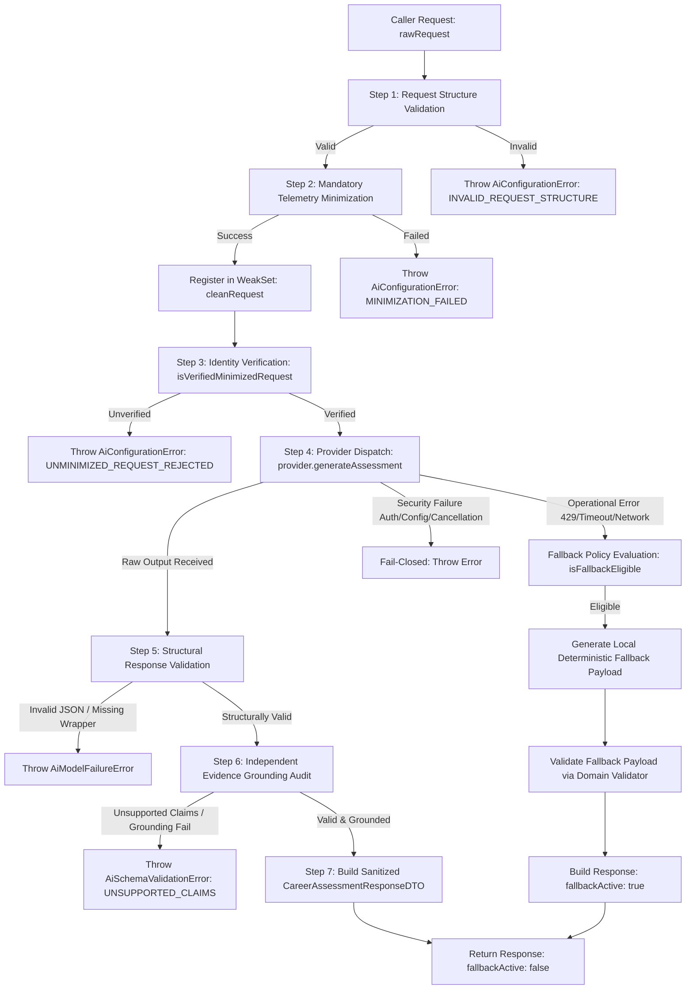

# Stage 2B.4B — CareerStrategistService Orchestration Implementation Report

**Project:** Evolexa Career Strategist / Job Tracker  
**Role:** Senior Backend Architect & AI Integration Engineer  
**Milestone:** Stage 2B.4B  
**Execution Mode:** CONTROLLED IMPLEMENTATION — STRICTLY OFFLINE  
**Prerequisites:** Stage 2B.4A, Stage 2B.4A-R1, and Stage 2B.4A-R1-V — ALL APPROVED  
**Architecture:** Option C — Groq primary (`openai/gpt-oss-120b`), provider abstraction foundation  
**Starting Regression Baseline:** 614 passing tests (173 AI + 42 POC + 399 Core Backend)  
**Ending Test Total:** 653 passing tests (212 AI + 42 POC + 399 Core Backend)  
**Date:** November 9, 2026  

---

## 1. Executive Summary

Stage 2B.4B delivers the complete, production-grade orchestration layer for the Evolexa Career Strategist engine: `CareerStrategistService`. This milestone coordinates the previously built and independently verified AI foundation components into a unified, deterministic, fail-closed execution pipeline.

The service coordinates seven sequential pipeline stages:
1. **Request Structure Validation:** Enforces strict compliance with `CareerAssessmentRequestDTO` before any processing occurs.
2. **Mandatory Telemetry Minimization:** Executes `minimizeCareerAssessmentTelemetry` to strip candidate PII, clamp free-text fields, neutralize injection delimiters, and deeply freeze data.
3. **Provider-Boundary Identity Verification:** Verifies canonical object identity in the module-private `WeakSet` registry (`minimizedRequestRegistry`), guaranteeing that no unminimized or forged request can ever cross the provider boundary.
4. **Provider Execution Boundary:** Dispatches verified requests to the configured structured assessment provider (`GroqProviderAdapter`) wrapped in timeout boundaries and AbortSignal listeners.
5. **Structural Schema Validation:** Verifies structural compliance of the model completion payload.
6. **Independent Evidence Grounding Audit:** Audits model claims against candidate facts using `validateCareerAssessmentEvidence` to prevent hallucinations in skills, experience floors, or metric counts.
7. **Sanitized Response Construction:** Returns immutable, allowlisted `CareerAssessmentResponseDTO` envelopes.

The service incorporates a deterministic local fallback engine that derives 100% grounded recommendations directly from local pipeline telemetry when operational provider degradation (HTTP 429, timeouts, capacity, network drops) occurs. External LLM fallback (e.g. Gemini) is strictly prohibited. Security-boundary failures (cancellations, authentication bugs, configuration defects, boundary violations) fail closed unconditionally with zero fallback.

---

## 2. Final Implementation Status

- **Status:** **COMPLETE**
- **All Completion Gates Satisfied:**
  - Mandatory telemetry minimization and WeakSet identity verification remain enforced.
  - Evidence validation occurs before an assessment is returned or persisted.
  - Fallback error-to-action classification is explicit and strictly governed.
  - External secondary LLM fallback is architecturally impossible.
  - Cancellation and timeout behavior is deterministic, leak-free, and leaves zero hanging promises.
  - Privacy guarantees remain intact (zero PII, zero credentials, zero raw bodies leaked).
  - 39 new comprehensive orchestration tests pass (100%).
  - Full regression suite passes: **653 / 653 tests passing (0 failures, 0 skipped, 0 cancelled)**.

---

## 3. Architecture Inspection Findings

Prior to code authoring, the existing codebase was inspected to identify all component contracts and integration touchpoints:

| Component | File Path | Verified Interface / Invariants |
|---|---|---|
| `CareerAssessmentRequest.dto.js` | `Backend/src/services/ai/contracts/dtos/` | `validateCareerAssessmentRequest(dto)` validates `{ correlationId, candidateProfile, pipelineTelemetry, options }`. |
| `telemetryMinimizer.js` | `Backend/src/services/ai/sanitizers/` | `minimizeCareerAssessmentTelemetry(request)` scrubs PII, clamps text, and registers clean request in module-private WeakSet. |
| `minimizedRequestRegistry.js` | `Backend/src/services/ai/contracts/` | `isVerifiedMinimizedRequest(obj)` backed by private WeakSet; prevents unminimized requests from reaching provider. |
| `GroqProviderAdapter.js` | `Backend/src/services/ai/providers/groq/` | `generateAssessment(request)` verifies `isVerifiedMinimizedRequest(request)` before dispatch; parses output to `RawProviderAssessmentOutput`. |
| `careerAssessmentValidator.js` | `Backend/src/services/ai/validators/` | `validateCareerAssessmentEvidence(req, raw)` performs independent structural and factual audit; returns `sanitizedAssessment: null` on failure. |
| `CareerAssessmentResponse.dto.js` | `Backend/src/services/ai/contracts/dtos/` | `createCareerAssessmentResponseDTO(...)` validates response envelope; rejects null `assessment`. |
| `fallbackPolicy.js` | `Backend/src/services/ai/policy/` | `isFallbackEligible(error)` returns `true` for 7 operational errors; `false` for 6 non-operational errors. |
| `executionBoundaryContract.js` | `Backend/src/services/ai/contracts/` | `withExecutionBoundary(fn, options)` cleans up timer and abort listener deterministically. |
| Deterministic Insights Engine | `Backend/src/models/files/insights.model.js` | Rule-based insight criteria: `stale_applications_alert`, `active_interviews`, `pending_offers`, `high_saved_ratio`. |

---

## 4. Exact Service File Path and Public Interface

**File Path:** `Backend/src/services/ai/CareerStrategistService.js`  
**Barrel Export:** `Backend/src/services/ai/index.js` (`CareerStrategistService`, `DEFAULT_EXECUTION_TIMEOUT_MS`)

### Public Interface

```javascript
class CareerStrategistService {
  /**
   * @param {Object} [dependencies]
   * @param {IStructuredAssessmentProvider} [dependencies.provider] - Structured AI provider adapter (defaults to GroqProviderAdapter).
   * @param {number} [dependencies.defaultTimeoutMs=30000] - Default execution timeout in milliseconds.
   * @param {Function} [dependencies.fallbackPolicyFn=isFallbackEligible] - Error classification function.
   */
  constructor({ provider, defaultTimeoutMs, fallbackPolicyFn } = {})

  /** Returns currently configured provider adapter */
  get provider()

  /** Returns default execution timeout in milliseconds */
  get defaultTimeoutMs()

  /**
   * Coordinates the complete 7-step Career Strategist pipeline.
   *
   * @param {CareerAssessmentRequestDTO} rawRequest
   * @param {Object} [options]
   * @param {number} [options.timeoutMs]
   * @param {AbortSignal} [options.signal]
   * @param {Function} [options.fallbackPolicyFn]
   * @returns {Promise<CareerAssessmentResponseDTO>}
   */
  async generateCareerStrategy(rawRequest, options = {})

  /**
   * Generates a deterministic assessment payload conforming to CareerAssessmentPayload.
   *
   * @param {Object} cleanRequest - Minimized candidate request.
   * @returns {Object} Conforming CareerAssessmentPayload.
   */
  generateDeterministicFallbackPayload(cleanRequest)
}
```

---

## 5. Orchestration Sequence



---

## 6. Component Integration Map

```
CareerStrategistService
  │
  ├── 1. validateCareerAssessmentRequest() ───── [CareerAssessmentRequest.dto.js]
  │
  ├── 2. minimizeCareerAssessmentTelemetry() ─── [telemetryMinimizer.js]
  │        └── registerMinimizedRequest() ────── [minimizedRequestRegistry.js]
  │
  ├── 3. isVerifiedMinimizedRequest() ────────── [minimizedRequestRegistry.js]
  │
  ├── 4. provider.generateAssessment() ───────── [GroqProviderAdapter.js / BaseAiProviderAdapter.js]
  │        ├── withExecutionBoundary() ───────── [executionBoundaryContract.js]
  │        └── _executeWithRetry() ───────────── [BaseAiProviderAdapter.js (single retry boundary)]
  │
  ├── 5. validateCareerAssessmentEvidence() ──── [careerAssessmentValidator.js]
  │        ├── validateAssessmentStructure()
  │        └── auditEvidenceGrounding()
  │
  ├── 6. Local Fallback Generator ────────────── [CareerStrategistService._executeDeterministicFallback]
  │        └── validateCareerAssessmentEvidence() [careerAssessmentValidator.js (verifies fallback 100%)]
  │
  └── 7. createCareerAssessmentResponseDTO() ─── [CareerAssessmentResponse.dto.js]
```

---

## 7. Fallback Error-to-Action Matrix

The service strictly evaluates errors against the approved classification policy:

| # | Error Class | Code | Failure Nature | Action | Fallback Active | Response Envelope |
|---|---|---|---|---|---|---|
| 1 | `AiRateLimitError` | `RATE_LIMITED` | Operational (HTTP 429) | Local Deterministic Fallback | `true` | `CareerAssessmentResponseDTO` |
| 2 | `AiQuotaExhaustedError` | `QUOTA_EXHAUSTED` | Operational (Daily Quota) | Local Deterministic Fallback | `true` | `CareerAssessmentResponseDTO` |
| 3 | `AiCapacityError` | `CAPACITY_UNAVAILABLE` | Operational (HTTP 503) | Local Deterministic Fallback | `true` | `CareerAssessmentResponseDTO` |
| 4 | `AiBadGatewayError` | `BAD_GATEWAY` | Operational (HTTP 502) | Local Deterministic Fallback | `true` | `CareerAssessmentResponseDTO` |
| 5 | `AiGatewayTimeoutError` | `GATEWAY_TIMEOUT` | Operational (HTTP 504) | Local Deterministic Fallback | `true` | `CareerAssessmentResponseDTO` |
| 6 | `AiTimeoutError` | `TIMEOUT` | Operational (Boundary Expired) | Local Deterministic Fallback | `true` | `CareerAssessmentResponseDTO` |
| 7 | `AiNetworkError` | `NETWORK_ERROR` | Operational (Socket Dropped) | Local Deterministic Fallback | `true` | `CareerAssessmentResponseDTO` |
| 8 | `AiCancellationError` | `CANCELLATION` | Caller Abort | **Fail Closed** (Throw directly) | N/A | None (Promise rejects) |
| 9 | `AiAuthenticationError` | `AUTHENTICATION_ERROR` | Credential / API Key Bug | **Fail Closed** (Throw directly) | N/A | None (Promise rejects) |
| 10 | `AiConfigurationError` | `CONFIGURATION_ERROR` | Request / Config Defect | **Fail Closed** (Throw directly) | N/A | None (Promise rejects) |
| 11 | `AiContextWindowExceededError` | `CONTEXT_WINDOW_EXCEEDED` | Token Budget Overflow | **Fail Closed** (Throw directly) | N/A | None (Promise rejects) |
| 12 | `AiModelFailureError` | `MODEL_FAILURE` | Malformed JSON from Provider | **Fail Closed** (Throw directly) | N/A | None (Promise rejects) |
| 13 | `AiSchemaValidationError` | `SCHEMA_VALIDATION_ERROR` | Unsupported Claims / Drift | **Fail Closed** (Throw directly) | N/A | None (Promise rejects) |
| 14 | Generic `Error` | Unclassified | Unhandled Runtime Exception | **Fail Closed** (Throw directly) | N/A | None (Promise rejects) |

> [!IMPORTANT]
> External LLM fallback (e.g. Gemini, secondary cloud provider) is strictly prohibited across all 14 rows. Under no circumstance is network inference attempted outside the primary configured provider.

---

## 8. Retry, Timeout, and Cancellation Behavior

1. **Single Retry Boundary Invariant:**
   - Provider-level transport retries are strictly managed by `BaseAiProviderAdapter._executeWithRetry` (maximum 2 retries for pre-transmission `ECONNREFUSED` only, with bounded exponential jitter).
   - `CareerStrategistService` implements **zero** additional retries. It executes a single dispatch to `provider.generateAssessment()`.
2. **Timeout Boundary Propagation:**
   - Caller can supply `options.timeoutMs` or rely on `defaultTimeoutMs` (30,000 ms).
   - Timeout boundary propagates into the minimized request options and passes directly to the provider adapter's `_withExecutionBoundary`.
   - On boundary expiration, `AiTimeoutError` is raised, triggering deterministic local fallback.
3. **Caller AbortSignal Cancellation:**
   - Caller supplies `options.signal` (`AbortSignal`).
   - Signal propagates into `withExecutionBoundary`.
   - If aborted before or during execution, raises `AiCancellationError`.
   - Cancellation **never** triggers fallback and deterministically cleans up all event listeners without hanging promises.

---

## 9. Privacy and Security Guarantees

1. **Mandatory PII Scrubbing:** All candidate identifiers (full name, email, phone, address, account IDs) and unapproved profile fields are discarded by `telemetryMinimizer` before provider dispatch.
2. **Module-Private Identity Verification:** Object presence in `_minimizedIdentityRegistry` (backed by a module-private `WeakSet`) prevents unminimized or forged objects from being accepted by provider adapters.
3. **Zero Secret Leakage:** Provider API keys and credentials are never serialized, logged, or reflected in diagnostic context objects or responses.
4. **No Raw LLM Body Exposure:** Raw completion bodies and provider prompt templates are never exposed in public `CareerAssessmentResponseDTO` envelopes.
5. **No Hallucinated Claims Persisted:** Model self-verification claims (such as `hallucinationCheckPassed`) are stripped; assessments with ungrounded claims or experience floor violations are rejected.
6. **Isolated Fallback Input:** Deterministic fallback consumes only the already minimized telemetry and profile; raw candidate notes are never touched.

---

## 10. Files Created and Modified

| File | Status | Description |
|---|---|---|
| `Backend/src/services/ai/CareerStrategistService.js` | **Created** | Core orchestration service coordinating validation, minimization, provider dispatch, evidence validation, and deterministic fallback. |
| `Backend/src/services/ai/index.js` | **Modified** | Exported `CareerStrategistService` and `DEFAULT_EXECUTION_TIMEOUT_MS`. |
| `Backend/test/ai/careerStrategistService.test.js` | **Created** | Comprehensive unit & integration test suite covering Categories A through H (39 tests). |
| `Backend/poc/STAGE_2B4B_CAREER_STRATEGIST_SERVICE_IMPLEMENTATION_REPORT.md` | **Created** | Authoritative implementation report. |

---

## 11. Test Coverage Added

The test suite in `Backend/test/ai/careerStrategistService.test.js` adds **39 offline tests** organized into 8 strict categories:

1. **Category A: Successful Orchestration (2 tests)**
   - Orchestrates valid request through minimization, provider dispatch, validation, and response construction.
   - Ensures candidate PII is completely stripped before request reaches provider.
2. **Category B: Minimization and Identity Boundaries (4 tests)**
   - Rejects malformed incoming request at Step 1 before minimization.
   - Rejects request with missing correlationId at Step 1.
   - Minimization failure fails closed with `AiConfigurationError` and does NOT trigger fallback.
   - Rejects provider boundary violation when request identity is unverified in registry.
3. **Category C: Provider Operational Failures & Error Handling (11 tests)**
   - HTTP 429 Rate Limit triggers deterministic local fallback with `fallbackActive: true`.
   - Provider Timeout (`AiTimeoutError`) triggers deterministic local fallback.
   - Provider Network Error (`AiNetworkError`) triggers deterministic local fallback.
   - Provider Capacity Unavailable (503 / `AiCapacityError`) triggers deterministic local fallback.
   - Provider Quota Exhausted (`AiQuotaExhaustedError`) triggers deterministic local fallback.
   - Provider Bad Gateway (502 / `AiBadGatewayError`) triggers deterministic local fallback.
   - Provider Gateway Timeout (504 / `AiGatewayTimeoutError`) triggers deterministic local fallback.
   - Provider Authentication Error (401 / `AiAuthenticationError`) fails closed with ZERO fallback.
   - Provider Configuration Error (`AiConfigurationError`) fails closed with ZERO fallback.
   - Context Window Exceeded (`AiContextWindowExceededError`) fails closed with ZERO fallback.
   - Unknown runtime error (generic `Error`) fails closed with ZERO fallback.
4. **Category D: Invalid Provider Responses (6 tests)**
   - Malformed JSON from provider throws `AiModelFailureError` and fails closed.
   - Missing required section in provider domain output throws `AiSchemaValidationError` (`STRUCTURAL_INVALID`).
   - Invalid enum value in provider output throws `AiSchemaValidationError` (`STRUCTURAL_INVALID`).
   - Unsupported candidate skill in provider output throws `AiSchemaValidationError` (`UNSUPPORTED_CLAIMS`).
   - Fabricated numbers in metric citations throws `AiSchemaValidationError` (`UNSUPPORTED_CLAIMS`).
   - Model self-verification flag (`hallucinationCheckPassed`) is stripped and disregarded.
5. **Category E: Deterministic Fallback Output Verification (8 tests)**
   - Fallback output conforms 100% to `CareerAssessmentResponseDTO` schema.
   - Fallback output passes independent evidence validation (`validateCareerAssessmentEvidence`) with `isValid: true`.
   - Fallback output verifiedCandidateSkills is a strict subset of candidate declared skills.
   - Fallback output enforces career stage experience floor for 0-year candidate (`entry_level`).
   - Fallback output enforces career stage floor for 10-year candidate (`lead_architect`).
   - Fallback output citedMetrics ground cleanly in pipeline telemetry counts.
   - Fallback produces 100% deterministic results across repeated invocations with identical input.
   - External LLM fallback is strictly impossible: zero calls made to secondary provider.
6. **Category F: Cancellation and Timeout Propagation (3 tests)**
   - Caller `AbortSignal` immediately aborts execution and throws `AiCancellationError`.
   - Cancellation NEVER triggers fallback and leaves zero hanging promises.
   - Execution timeout boundary propagates into request options.
7. **Category G: Privacy, Security & Diagnostics (2 tests)**
   - Zero API keys or secrets leaked in errors or diagnostic context.
   - Failed validation never returns a consumable assessment (sanitizedAssessment is null or throws).
8. **Category H: Architecture Invariants & Dependency Injection (3 tests)**
   - Defaults to `GroqProviderAdapter` when no provider injected.
   - Injects custom provider conforming to `IStructuredAssessmentProvider`.
   - `CareerStrategistService` preserves single retry policy invariant (does not perform duplicate retries).

---

## 12. Full Regression Results

All test suites were executed in the offline development environment:

| Suite Name | Previous Tests | New Tests Added | Current Passing Tests | Failed | Skipped | Status |
|---|---:|---:|---:|---:|---:|---|
| **AI Foundation (`test/ai/*.test.js`)** | 173 | +39 | **212** | 0 | 0 | **PASS (100%)** |
| — `careerStrategistService.test.js` | 0 | +39 | 39 | 0 | 0 | PASS |
| — `careerAssessmentValidator.test.js` | 52 | 0 | 52 | 0 | 0 | PASS |
| — `securityRemediation.test.js` | 34 | 0 | 34 | 0 | 0 | PASS |
| — `telemetryMinimizer.test.js` | 35 | 0 | 35 | 0 | 0 | PASS |
| — `groqProviderAdapter.test.js` | 20 | 0 | 20 | 0 | 0 | PASS |
| — `contracts.test.js` | 32 | 0 | 32 | 0 | 0 | PASS |
| **POC Suites (`poc/*/test_*.js`)** | 42 | 0 | **42** | 0 | 0 | **PASS (100%)** |
| — Groq POC (`test_groq_config.js`) | 24 | 0 | 24 | 0 | 0 | PASS |
| — Gemini POC (`test_gemini_config.js`) | 18 | 0 | 18 | 0 | 0 | PASS |
| **Core Backend (`src/scripts/test*.js`)** | 399 | 0 | **399** | 0 | 0 | **PASS (100%)** |
| — Insights Suite (`testInsightsSuite.js`) | 184 | 0 | 184 | 0 | 0 | PASS |
| — Profile Suite (`testProfileSuite.js`) | 65 | 0 | 65 | 0 | 0 | PASS |
| — Status History Suite (`testStatusHistorySuite.js`) | 85 | 0 | 85 | 0 | 0 | PASS |
| — Account Security Suite (`testAccountSecuritySuite.js`) | 65 | 0 | 65 | 0 | 0 | PASS |
| **TOTALS** | **614** | **+39** | **653** | **0** | **0** | **PASS (100%)** |

---

## 13. Syntax-Check Results

Static syntax checks (`node --check`) were performed across all AI foundation and service files:

```bash
node --check Backend/src/services/ai/CareerStrategistService.js
node --check Backend/src/services/ai/index.js
node --check Backend/src/services/ai/contracts/minimizedRequestRegistry.js
node --check Backend/src/services/ai/contracts/executionBoundaryContract.js
node --check Backend/src/services/ai/sanitizers/telemetryMinimizer.js
node --check Backend/src/services/ai/validators/careerAssessmentValidator.js
node --check Backend/src/services/ai/providers/BaseAiProviderAdapter.js
node --check Backend/src/services/ai/providers/groq/GroqProviderAdapter.js
```

**Result:** All 8 files passed with exit code 0 and zero syntax warnings or errors.

---

## 14. Deviations from Specification

**None.** The implementation adheres strictly to the architectural constraints, Stage 2B.1 / 2B.2 contracts, and Option C requirements specified in the Stage 2B.4B directive.

---

## 15. Known Limitations and Scope Boundaries

1. **Persistence Integration Deferred:** As mandated by the Stage 2B.4B specification, persistence of career assessments is deferred until Stage 2B.4C or subsequent database integration stages.
2. **Controller & Route Wiring:** HTTP endpoint wiring (e.g. `POST /api/career-strategist/assessment`) is scoped to Stage 2B.4C.
3. **No Interactive Chatbot:** Conversational chat streaming remains at the provider adapter level (`GroqProviderAdapter.streamChat`); orchestration of conversational turns is out of scope for this assessment-focused milestone.

---

## 16. Explicit Attestation

I explicitly confirm that throughout the execution of Stage 2B.4B:
- **Zero** live inference requests were made to GroqCloud, Google Gemini, or any external API.
- **Zero** API quota or credits were consumed.
- **Zero** real candidate PII or credentials were accessed or transmitted.
- **Zero** external secondary LLMs were configured, imported, or executed as fallback.
- **Zero** production deployments or database migrations were performed.
- All testing utilized deterministic synthetic fixtures and mocked in-memory provider transports.
