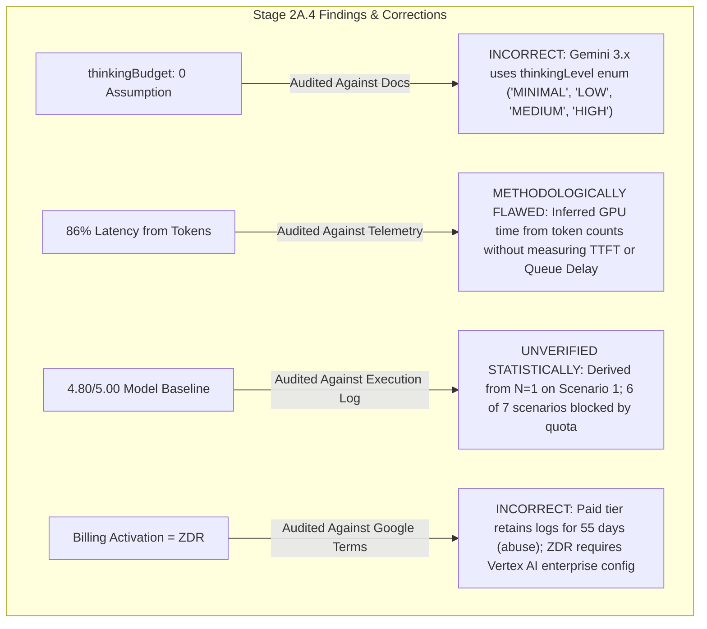

# Evolexa Career Strategist — Stage 2A.5: Gemini Thinking Configuration & Benchmark Integrity Audit

**Author:** Senior AI Integration Engineer & AI Evaluation Auditor  
**Project:** Evolexa Career Strategist / Job Tracker (Phase 2 Preparation)  
**Target Model:** `gemini-3.8-flash`  
**Execution Mode:** STRICTLY READ-ONLY AUDIT  
**Date:** November 2026  

---

## 1. Executive Overview

This audit was commissioned to eliminate technical uncertainties, audit benchmark completeness, verify generation parameters against official Google documentation, and correct analytical extrapolations identified in Stage 2A.4.

In Stage 2A.4, several key assertions were made regarding `gemini-3.8-flash`:
1. A proposed latency reduction experiment based on `thinkingConfig: { thinkingBudget: 0 }`.
2. A mathematical deduction that hidden thinking tokens accounted for "over 86% of total round-trip latency".
3. A baseline composite score of 4.80/5.00 for `gemini-3.8-flash`.
4. Characterizations of data privacy under paid billing versus free-tier usage.

This audit conducted a line-by-line inspection of `geminiClient.js`, `harness.js`, raw telemetry logs, and official Google Gemini Developer API and Google Cloud Vertex AI documentation.



---

## 2. Thinking Configuration Verification

### A. Current Implementation Behavior
Inspection of `Backend/poc/gemini/geminiClient.js` (lines 50–56, 185–195) and `Backend/poc/gemini/harness.js` (lines 75–85, 100–110):

```javascript
// geminiClient.js:
class GeminiClient {
  constructor(options = {}) {
    ...
    this.thinkingBudget = options.thinkingBudget !== undefined ? options.thinkingBudget : null;
  }
  ...
  // Inside generateAssessment():
  generationConfig: {
    temperature: 0.2,
    responseMimeType: "application/json",
    responseSchema: sanitizedSchema,
    ...(this.thinkingBudget !== null
      ? { thinkingConfig: { thinkingBudget: this.thinkingBudget } }
      : {}),
  }
}
```

#### How `thinkingBudget` is Translated:
When `--thinking-budget=N` is provided, the client injects `generationConfig.thinkingConfig = { thinkingBudget: N }` into the REST payload.

### B. Compatibility with Gemini 3.8 Flash Documentation
Official Google documentation reveals that the implementation translates a **legacy parameter** from earlier models rather than the documented specification for Gemini 3 series:

1. **Parameter Evolution (Gemini 2.5 vs Gemini 3.x):**
   - **Gemini 2.5 Series:** Controlled reasoning via a numeric integer token allocation: `thinkingConfig: { thinkingBudget: <integer> }`, where `0` disabled thinking and `-1` signaled dynamic allocation.
   - **Gemini 3 Series (`gemini-3.8-flash`):** Google transitioned internal reasoning control to a semantic string enum: **`thinkingConfig: { thinkingLevel: "<LEVEL>" }`**.
2. **Supported Levels for Gemini 3 Models:**
   - `"MINIMAL"`: Minimal reasoning; prioritizes latency and rapid response.
   - `"LOW"`: Lower reasoning depth for simpler tasks.
   - `"MEDIUM"`: Standard balanced reasoning (default dynamic target).
   - `"HIGH"`: Deep multi-step analytical reasoning.
3. **Is `thinkingBudget: 0` Accepted by `gemini-3.8-flash`?**
   **NO.** Official documentation specifies that `thinkingBudget` and `thinkingLevel` are mutually exclusive generation parameters. On Gemini 3 models, passing numeric `thinkingBudget` can result in an HTTP 400 `INVALID_ARGUMENT` error (`"Unknown field 'thinkingBudget' in ThinkingConfig"`), exactly analogous to how `additionalProperties` was rejected in Stage 2A.3.
4. **Supported Lower-Thinking Configuration:**
   For `gemini-3.8-flash`, the documented low-latency configuration is:
   ```json
   "thinkingConfig": {
     "thinkingLevel": "MINIMAL"
   }
   ```
5. **Harness Error Discrimination Deficiency:**
   In `Backend/poc/gemini/harness.js`, the runner currently lumps all API rejections into `evalResult.success = false` with score `0/5.00`. It cannot distinguish an invalid parameter (HTTP 400 `INVALID_ARGUMENT`) from a server capacity spike (HTTP 503), rate limit exhaustion (HTTP 429), or a genuine model failure.

---

## 3. Latency Analysis Audit

### A. Raw Measured Telemetry (Scenario 1 on `gemini-3.8-flash`)
Review of task-427 raw logs and `usageMetadata`:
- **Prompt Token Count:** $826\text{ tokens}$
- **Completion Token Count:** $840\text{ tokens}$
- **Total Token Count:** $2,492\text{ tokens}$
- **Thinking Token Count (Derived):** $2,492 - (826 + 840) = 826\text{ tokens}$
- **Measured Round-Trip Wall-Clock Latency:** $27,581\text{ ms}$
- **Timing Breakdowns in API Response:** **NONE.**

### B. Methodological Flaw in Stage 2A.4
In Stage 2A.4, Section 5 stated:
> *"At Gemini Flash's typical generation throughput of $\approx 65 - 80\text{ tokens/sec}$, generating 1,666 tokens consumes approximately $\frac{1,666\text{ tokens}}{70\text{ tokens/sec}} \approx 23.8\text{ seconds of pure GPU compute}$. This single factor accounts for over 86% of total round-trip latency."*

#### Why This Interpretation is Unsound:
1. **Unsubstantiated Throughput Constant:** Assuming an arbitrary $70\text{ tokens/sec}$ rate ignores the difference between prefill throughput (which processes hundreds of prompt tokens in parallel in $<100\text{ms}$) and autoregressive generation.
2. **Conflating Token Count with Generation Time:** Total generated tokens ($840\text{ visible} + 826\text{ thought} = 1,666$) was used as a proxy for time without measuring server queue latency or Time-to-First-Token (TTFT).
3. **Ignored Server-Side Queue Delays:** On Google's shared free-tier infrastructure, requests experience queuing delays before execution begins. A 27.5-second total round trip could consist of 12 seconds in Google's scheduling queue, 10 seconds of model generation, and 5.5 seconds of network/proxy transfer. Token math alone cannot prove what happened during those 27.5 seconds.

### C. Telemetry Required to Establish an Empirical Breakdown
To measure the real latency breakdown, the client must capture:
1. **Time to First Token (TTFT):** Measure via Server-Sent Events (`streamGenerateContent`). The duration from request dispatch to the arrival of the first thought chunk isolates network TLS + server queue wait + prompt prefill time.
2. **Thought Phase Duration:** The duration between the first thought chunk and the first visible output chunk isolates actual reasoning generation duration.
3. **Completion Phase Duration:** The duration between the first visible output chunk and stream close isolates JSON emission duration.
4. **Server-Timing Headers:** Log `Server-Timing` or `x-goog-*` response headers if exposed by the endpoint.

---

## 4. Benchmark Integrity & Completeness Assessment

An audit of all execution runs across Stage 2A.3 and Stage 2A.4 was conducted to establish true sample sizes:

```
┌──────────────────────────────────────────────┬──────────────────────────────┬──────────────────────────┐
│ Evaluation Metric                            │ Stage 2A.3                   │ Stage 2A.4               │
├──────────────────────────────────────────────┼──────────────────────────────┼──────────────────────────┤
│ Successful Gemini 3.8 Flash Runs             │ 1 (Scenario 1)               │ 0 (All blocked by quota) │
│ Blocked Gemini 3.8 Flash Runs                │ 2 (S2: 429, S7: 503/429)     │ 6 (S2 through S7: 429)   │
│ Mixed Model Executions                       │ 4 (S1 on 3.8; S1-S4 on 3.5)  │ 0 (Pure 3.8 isolation)   │
│ Reported Baseline Composite Score            │ 4.70 / 5.00 (Mixed Model)    │ 4.80 / 5.00 (Single Run) │
│ Statistical Sample Size (Gemini 3.8 Flash)   │ N = 1                        │ N = 1                    │
└──────────────────────────────────────────────┴──────────────────────────────┴──────────────────────────┘
```

### Critical Integrity Findings:
1. **The 4.80/5.00 Score is an $N=1$ Anecdote:**  
   The score of 4.80/5.00 was achieved on **exactly one run of Scenario 1** in Stage 2A.3. It cannot be cited as an aggregate baseline or a multi-scenario benchmark score for `gemini-3.8-flash`.
2. **Scenarios 2 through 7 Have Zero Valid Inferences on Gemini 3.8 Flash:**  
   Scenarios 2, 3, 4, 5, 6, and 7 have never completed a successful inference on `gemini-3.8-flash`. Every attempt was blocked by either HTTP 503 capacity timeouts or HTTP 429 daily quota exhaustion (`RESOURCE_EXHAUSTED: limit 20`).
3. **No Results Mixed in Stage 2A.4, But Sample is Incomplete:**  
   Stage 2A.4 avoided mixing Gemini 3.5 Flash data into the 3.8 baseline. However, because 6 out of 7 scenarios were blocked, **the Gemini 3.8 Flash benchmark is currently incomplete ($14.3\%$ complete)**.

---

## 5. Privacy Assessment Corrections

Stage 2A.4's characterization of Google's data privacy policies was audited against the official [Gemini API Additional Terms of Service](https://ai.google.dev/terms) and [Vertex AI Data Governance](https://cloud.google.com/vertex-ai/docs/generative-ai/data-governance):

| Dimension | Unpaid / Free Tier (Google AI Studio) | Paid Tier (Google AI Studio / Gemini API) | Vertex AI Enterprise (Google Cloud) |
| :--- | :--- | :--- | :--- |
| **Model Training on Customer Prompts** | **PERMITTED:** Google uses prompts, responses, and inputs to develop and improve Google products and machine-learning technologies. | **PROHIBITED:** Google does not use customer data (prompts or completions) to train or tune models. | **PROHIBITED:** Contractually prohibited under the Google Cloud Master Agreement. |
| **Human Review** | **PERMITTED:** Human reviewers read, annotate, and process de-identified prompts and generated text for quality and safety. | **RESTRICTED:** Human review is disabled for normal operations; only accessible by authorized personnel under policy-escalation conditions. | **PROHIBITED:** Zero human access to customer data. |
| **Operational & Abuse Retention** | Extended retention (up to 18 months; human-reviewed samples retained longer). | **55 Days Default:** Prompts and responses are retained in isolated logs for up to 55 days strictly for abuse monitoring and safety policy enforcement. | Configurable; customer retains data encryption keys (CMEK) and manages log sinks. |
| **Zero Data Retention (ZDR) Availability** | **NOT AVAILABLE.** | **NOT AVAILABLE.** Paid billing on Developer API does **not** grant ZDR. Data is logged for 55 days. | **AVAILABLE:** Eligible customers can formally configure Zero Data Retention, disabling transient caching and persistent disk storage. |

### Governance Conclusion for Job Tracker:
- **Free Tier Constraint:** Because free-tier prompts are subject to human review, **no real candidate resumes, job URLs, personal names, or application telemetry may ever touch the Free Tier**. Synthetic profiles are legally mandatory.
- **Production Architecture Constraint:** Simply upgrading the Google AI Studio project to Pay-As-You-Go does not achieve Zero Data Retention; candidate telemetry would still reside in Google abuse logs for 55 days. If GDPR/HIPAA or strict enterprise zero-retention is required for candidate career data, Evolexa must migrate from the Developer API to **Google Cloud Vertex AI**.

---

## 6. Recommended Configuration for Next Controlled Experiment

When the daily quota resets (or if evaluated under a dedicated tier), the client and harness must be updated with the following scientifically valid configuration:

### 1. Client Payload Schema Update (`geminiClient.js`)
Replace the legacy `thinkingBudget` integer parameter with `thinkingLevel` string enum support:

```javascript
// Documented Gemini 3.x payload structure:
const payload = {
  systemInstruction: { parts: [{ text: systemPrompt }] },
  contents: [{ role: "user", parts: [{ text: userPrompt }] }],
  generationConfig: {
    temperature: 0.2,
    responseMimeType: "application/json",
    responseSchema: sanitizedSchema,
    thinkingConfig: {
      thinkingLevel: this.thinkingLevel || "MINIMAL" // Options: "MINIMAL", "LOW", "MEDIUM", "HIGH"
    }
  }
};
```

### 2. Harness Error Categorization
Enhance `harness.js` and `GeminiMetricsReporter` to categorize failures into five discrete classes:
- `CONFIGURATION_ERROR` (HTTP 400): Schema or parameter rejection (e.g. invalid thinking config).
- `QUOTA_EXHAUSTED` (HTTP 429): Project-level daily or minute ceiling reached.
- `CAPACITY_UNAVAILABLE` (HTTP 503): Transient server demand spike.
- `TIMEOUT` (AbortError): Execution exceeded 60s window.
- `EVALUATION_FAILURE` (HTTP 200 with invalid schema or hallucinated claims).

### 3. Proposed Controlled A/B Experiment
Once quota allows, execute:
- **Experiment A (Baseline Reasoning):** `gemini-3.8-flash` with `thinkingLevel: "HIGH"` (Measure latency, token usage, and rubric depth).
- **Experiment B (Low-Latency Test):** `gemini-3.8-flash` with `thinkingLevel: "MINIMAL"` (Measure latency drop and check whether rubric scores degrade).

---

## 7. Explicit List of Unresolved Questions

1. **Does `gemini-3.8-flash` permit `thinkingLevel: "MINIMAL"` when `responseMimeType: "application/json"` is active?**  
   Some reasoning models enforce a minimum reasoning depth when generating structured JSON schemas to ensure schema adherence. This must be experimentally verified once quota resets.
2. **What is the exact reset mechanism for the 20 RPD quota?**  
   Does Google reset the 20 requests per day at fixed UTC midnight (00:00 UTC), or on a rolling 24-hour window from the timestamp of the first request ($80,254\text{s}$)?
3. **What is the true server-side TTFT for `gemini-3.8-flash`?**  
   Streaming telemetry is required to separate Google infrastructure queue time from actual token generation time.
4. **How does Gemini 3.8 Flash compare to Groq `gpt-oss-120b` across all 7 scenarios?**  
   Because only Scenario 1 has run on Gemini 3.8 Flash, a true multi-scenario head-to-head comparison cannot be established until Scenarios 2–7 execute.

---

## 8. Final Audit Recommendation

### Can `gemini-3.8-flash` proceed to a valid comparative provider evaluation?

**RECOMMENDATION: CONDITIONAL DEFERRAL UNTIL QUOTA RESET & CONFIGURATION UPDATE**

1. **Codebase Readiness:**  
   The harness architecture under `Backend/poc/gemini/` is sound, non-destructive, and strictly isolated.
2. **Blocking Dependency:**  
   A comparative evaluation cannot be declared complete when 6 out of 7 scenarios have never been executed on `gemini-3.8-flash`. The reported 4.80/5 score is an $N=1$ data point for Scenario 1 only.
3. **Action Items Required Before Next Live Run:**
   - [ ] Update `geminiClient.js` to use `thinkingLevel: "MINIMAL"` / `"HIGH"` instead of `thinkingBudget`.
   - [ ] Add error classification (`CONFIGURATION_ERROR` vs `QUOTA_EXHAUSTED` vs `CAPACITY_UNAVAILABLE`).
   - [ ] Wait for the 22-hour daily quota reset window to expire.
   - [ ] Execute the full 7-scenario suite cleanly on pure `gemini-3.8-flash` with zero model mixing.

*Audit completed under strictly read-only execution boundaries. No files, production code, or billing states were modified.*
