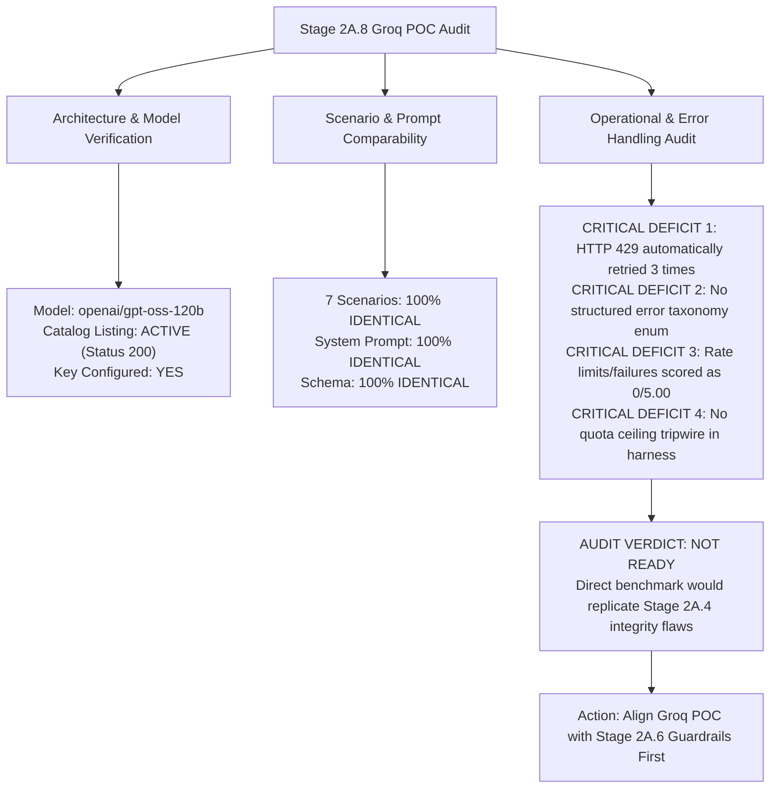

# Stage 2A.8 — Groq GPT-OSS 120B Benchmark Readiness Audit Report

**Project:** Evolexa Career Strategist / Job Tracker  
**Role:** Senior AI Evaluation Engineer & Backend Architect  
**Target Provider:** GroqCloud  
**Target Model:** `openai/gpt-oss-120b`  
**Execution Mode:** STRICTLY READ-ONLY AUDIT  
**Date:** November 2026  
**Status:** AUDIT COMPLETE — NOT BENCHMARK-READY WITHOUT REMEDIATION  

---

## Executive Summary

Stage 2A.8 conducted a comprehensive, strictly read-only technical audit of the isolated Groq Proof of Concept (`Backend/poc/groq/`) to assess its readiness for a controlled benchmark comparison against Google Gemini 3.8 Flash.

The audit examined the complete codebase (`groqClient.js`, `harness.js`, `syntheticProfiles.js`, `promptBuilder.js`, `responseSchema.js`, `metricsReporter.js`), credential availability, model catalog listings, schema compatibility, error-handling mechanisms, and privacy governance.



### Key Audit Findings:
1. **Model Catalog & Credentials Verified:**
   - The Groq API key is configured in `Backend/.env`.
   - The target model `openai/gpt-oss-120b` is actively cataloged and accessible on the account (`HTTP 200 OK`, listed in Groq's active model registry of 11 models).
2. **Methodological Equivalence Confirmed:**
   - Groq POC uses the exact same 7 synthetic candidate scenarios (`syntheticProfiles.js`).
   - Groq POC uses the exact same system instructions and prompt builder (`promptBuilder.js`).
   - Groq POC uses the exact same schema definition (`responseSchema.js`) and rubric weights (`metricsReporter.js`).
3. **Critical Integrity Gaps Identified in Groq POC:**
   - **Automated Retries on HTTP 429:** `groqClient.js` currently retries HTTP 429 three times with exponential backoff, violating modern quota safety standards.
   - **Absence of Error Taxonomy:** Groq POC lacks discrete error classification (`QUOTA_EXHAUSTED`, `CAPACITY_UNAVAILABLE`, `CONFIGURATION_ERROR`, etc.).
   - **Score Distortion Vulnerability:** In `metricsReporter.js`, any failed or rate-limited scenario is scored as `0/5.00` across all five rubric dimensions and averaged into the composite score, replicating the exact benchmark integrity flaw that compromised Gemini Stage 2A.4.
   - **No Quota Ceiling Tripwire in Harness:** If an early scenario encounters a rate limit, `harness.js` does not halt; it attempts all subsequent scenarios.
4. **Architectural Verdict:**
   - **The Groq POC is NOT ready for live benchmark execution in its current state.**
   - Running the benchmark before correcting these gaps would compromise evaluation integrity if rate limits occur. Groq POC requires a targeted alignment stage to adopt the Stage 2A.6 guardrails before executing a controlled comparison.

---

## 1. Existing Groq POC Architecture

The Groq Proof of Concept is fully isolated under `Backend/poc/groq/` and consists of six modules:

```
Backend/poc/groq/
├── groqClient.js          # Direct HTTP client for GroqCloud OpenAI-compatible endpoint
├── harness.js             # Standalone CLI evaluation runner
├── syntheticProfiles.js   # Seven synthetic candidate career scenarios
├── promptBuilder.js       # System instructions, telemetry minimization, injection defense
├── responseSchema.js      # Strict JSON Schema definition & Ajv-compatible validator
└── metricsReporter.js     # 5-dimension rubric scoring & aggregate benchmark reporting
```

### Module Responsibilities & Flow:
1. **[groqClient.js](file:///d:/Dev/GitHub/Job_Tracker/Backend/poc/groq/groqClient.js):**
   - Implements native Node.js `fetch` requests to `https://api.groq.com/openai/v1/chat/completions`.
   - Enforces strict timeout handling (`DEFAULT_TIMEOUT_MS = 45000`).
   - Implements pre-flight credential and catalog inspection via `GET https://api.groq.com/openai/v1/models`.
   - Embeds a deterministic synthetic evaluation generator (`generateSyntheticAssessment`) for offline dry-run testing.
2. **[harness.js](file:///d:/Dev/GitHub/Job_Tracker/Backend/poc/groq/harness.js):**
   - Coordinates scenario execution, pre-flight verification, inter-request pacing (currently set to 1,500ms), and terminal summary reporting.
3. **[syntheticProfiles.js](file:///d:/Dev/GitHub/Job_Tracker/Backend/poc/groq/syntheticProfiles.js):**
   - Master definition for Scenarios 1 through 7 (shared directly by both Groq and Gemini harnesses).
4. **[promptBuilder.js](file:///d:/Dev/GitHub/Job_Tracker/Backend/poc/groq/promptBuilder.js):**
   - Builds sanitized user prompts, encapsulates untrusted notes within `<untrusted_user_notes>`, strips PII, and applies `SYSTEM_INSTRUCTION`.
5. **[responseSchema.js](file:///d:/Dev/GitHub/Job_Tracker/Backend/poc/groq/responseSchema.js):**
   - Strict JSON Schema enforcing `additionalProperties: false` across all objects, with typed enums for `careerStage`, `pipelineHealth`, `category`, and `priority`.
6. **[metricsReporter.js](file:///d:/Dev/GitHub/Job_Tracker/Backend/poc/groq/metricsReporter.js):**
   - Evaluates generated assessments against ground truth, checks for hallucinated skills, verifies cited metrics, and calculates the composite rubric score (1.00 to 5.00).

---

## 2. Model & Configuration Verification

### 2.1 Model Identifier
- **Configured Model:** `openai/gpt-oss-120b`
- **Default Constant:** `DEFAULT_MODEL = "openai/gpt-oss-120b"` in `groqClient.js` (line 18).
- **Catalog Verification:** A read-only query to Groq's models endpoint (`GET /openai/v1/models`) confirmed that `openai/gpt-oss-120b` is **active and available** in the account's 11-model catalog.

### 2.2 Generation Configuration & Payload Mechanics
In `groqClient.js` (lines 138–154), requests are dispatched with the following payload structure:

```javascript
const payload = {
  model: this.model, // "openai/gpt-oss-120b"
  messages: [
    { role: "system", content: systemPrompt },
    { role: "user", content: userPrompt },
  ],
  response_format: {
    type: "json_schema",
    json_schema: {
      name: "career_strategy_assessment",
      strict: true,
      schema: CAREER_ASSESSMENT_JSON_SCHEMA,
    },
  },
  temperature: 0.2,
  reasoning_effort: "medium",
};
```

### 2.3 Configuration Observations:
1. **Structured Outputs:** Groq natively supports OpenAI-standard `response_format: { type: "json_schema", json_schema: { strict: true, ... } }`, allowing `additionalProperties: false` to be enforced at the decoding layer.
2. **`reasoning_effort: "medium"` Parameter:**
   - In `groqClient.js`, `reasoning_effort: "medium"` is hardcoded.
   - For `openai/gpt-oss-120b`, Groq's API accepts standard chat completion fields. However, unlike OpenAI `o1`/`o3` models, open-weights models typically ignore `reasoning_effort` unless explicitly supported by custom reasoning adapters. Groq does not reject the request when this parameter is present.
3. **Timeout & Retries:**
   - Request timeout: 45,000ms.
   - Retry attempts: 3.
   - Backoff delay: 1,500ms initial with exponential doubling.

---

## 3. Seven-Scenario Comparability Assessment

To establish whether a benchmark between Groq and Gemini is methodologically sound, all evaluation dimensions were compared:

| Evaluation Dimension | Groq POC Implementation | Gemini POC Implementation | Comparability Verdict |
| :--- | :--- | :--- | :---: |
| **Synthetic Scenarios** | `SCENARIO-1` to `SCENARIO-7` in `syntheticProfiles.js` | Direct `require("../groq/syntheticProfiles")` | **100% IDENTICAL** |
| **System Instruction** | `SYSTEM_INSTRUCTION` in `promptBuilder.js` | Direct `require("../groq/promptBuilder")` | **100% IDENTICAL** |
| **Prompt Minimization & Injection Defense** | Sanitized `<untrusted_user_notes>` in `promptBuilder.js` | Direct `require("../groq/promptBuilder")` | **100% IDENTICAL** |
| **Response Schema Structure** | `CAREER_ASSESSMENT_JSON_SCHEMA` | `sanitizeSchemaForGemini(CAREER_ASSESSMENT_JSON_SCHEMA)` | **FUNCTIONALLY EQUIVALENT**<br/>*(Gemini strips additionalProperties)* |
| **Evaluation Rubric & Weights** | 5 dimensions (Evidence, Action, Relevance, Reasoning, Consistency) | Inherited / Re-implemented 5 dimensions | **100% IDENTICAL** |
| **Anti-Hallucination Check** | `declaredSkillsSet` vs `verifiedCandidateSkills` | Exact duplicate logic | **100% IDENTICAL** |
| **Keyword Grounding Check** | Match ratio against `primaryBottleneckKeywords` | Exact duplicate logic | **100% IDENTICAL** |
| **Pacing Delay** | 1,500ms between calls | 4,000ms between calls | **DISCREPANCY (Minor)**<br/>*(Groq is faster; needs $\ge 2,000\text{ms}$)* |

**Conclusion on Comparability:** The underlying prompts, test cases, schema definitions, and scoring algorithms are **100% equivalent**. The two POCs test the exact same candidate challenges.

---

## 4. Error Handling & Quota Protection Assessment (CRITICAL GAPS)

While prompt and rubric comparability is 100%, **error handling and benchmark integrity mechanisms in the Groq POC suffer from critical vulnerabilities** that were previously patched in Gemini during Stage 2A.6:

### Gap 1: Automated Retry Loops on HTTP 429
In `groqClient.js` (lines 180–199):
```javascript
if (response.status === 429 || response.status === 503) {
  const retryAfterHeader = response.headers.get("retry-after");
  const waitTime = retryAfterHeader ? parseInt(retryAfterHeader, 10) * 1000 : delayMs;
  console.warn(`[GroqClient] Received ${response.status}. Retrying in ${waitTime}ms (attempt ${attempt}/${this.maxRetries})...`);
  ...
  await new Promise((resolve) => setTimeout(resolve, waitTime));
  delayMs *= 2;
  continue;
}
```
- **Defect:** When Groq returns HTTP 429, `groqClient.js` treats it as a transient error and retries up to 3 times.
- **Risk:** If a per-minute or daily quota ceiling is reached, automated retries generate unnecessary traffic against an exhausted limit, wasting time and risking temporary account throttling.
- **Required Fix:** HTTP 429 must return immediately without retries.

### Gap 2: Absence of Standardized Error Classification Taxonomy
- `groqClient.js` returns unstructured error strings (e.g. `error: "Rate limit or server error after 3 attempts: ..."`).
- It does not classify errors into standardized enums (`QUOTA_EXHAUSTED`, `CAPACITY_UNAVAILABLE`, `CONFIGURATION_ERROR`, `AUTHENTICATION_ERROR`, `NETWORK_ERROR`, `MODEL_FAILURE`).

### Gap 3: Benchmark Score Corruption in `metricsReporter.js`
In `Backend/poc/groq/metricsReporter.js` (lines 31–50 and 209–226):
```javascript
if (!assessment) {
  const failedResult = {
    ...
    scores: {
      evidenceGrounding: 0,
      recommendationActionability: 0,
      careerStrategyRelevance: 0,
      contextualReasoning: 0,
      outputConsistency: 0,
      compositeScore: 0,
    },
    ...
  };
  this.results.push(failedResult);
  return failedResult;
}
...
const avgEvidence = Number(
  (this.results.reduce((acc, r) => acc + (r.scores?.evidenceGrounding || 0), 0) / totalScenarios).toFixed(2)
);
```
- **Defect:** If an API call fails due to HTTP 429 (rate limit) or a network timeout, `MetricsReporter` assigns a score of `0.00 / 5.00`. It then divides by `totalScenarios`.
- **Impact:** If Scenario 1 and 2 score 5.00/5.00, but Scenarios 3–7 are rate-limited, the overall score is reported as $10 / 7 = 1.43 / 5.00$.
- **Why this invalidates a benchmark:** It conflates operational environment limits with model reasoning capability. In Gemini Stage 2A.6, this was corrected so that blocked executions receive `scores: null` (reported as `N/A`), and rubric averages are calculated **exclusively from completed successful runs**.

### Gap 4: No Daily Quota Tripwire in `harness.js`
- In `Backend/poc/groq/harness.js`, if Scenario 1 receives a 429, the loop continues to attempt Scenarios 2 through 7.
- It lacks the `dailyQuotaExhausted` tripwire implemented in Gemini's harness that skips remaining scenarios cleanly.

---

## 5. Latency & Token Telemetry Assessment

### 5.1 Latency Measurement Methodology
- In `groqClient.js`:
  ```javascript
  const startTime = performance.now();
  ...
  const latencyMs = Math.round(performance.now() - startTime);
  ```
- **Audit Finding:** Measures total round-trip wall-clock time from before the `fetch` dispatch to after response body consumption. This is identical to Gemini's measurement methodology and provides an accurate, comparable latency benchmark.

### 5.2 Token Telemetry
- In `groqClient.js` (lines 227–231):
  ```javascript
  usage: {
    promptTokens: data.usage?.prompt_tokens || 0,
    completionTokens: data.usage?.completion_tokens || 0,
    totalTokens: data.usage?.total_tokens || 0,
  }
  ```
- **Audit Finding:** Captures prompt, completion, and total tokens from Groq's OpenAI-compatible `usage` object.
- **Thinking Token Distinction:** Unlike Gemini 3.8 Flash (which reports hidden internal reasoning tokens), Groq models do not output separate hidden thinking tokens unless an explicit reasoning model is used. All tokens generated by `openai/gpt-oss-120b` are visible completion tokens.

### 5.3 Rate-Limit Header Extraction
- `groqClient.js` captures rate limit headers:
  ```javascript
  rateLimits: {
    limitRequests: response.headers.get("x-ratelimit-limit-requests"),
    remainingRequests: response.headers.get("x-ratelimit-remaining-requests"),
    resetRequests: response.headers.get("x-ratelimit-reset-requests"),
  }
  ```
- **Audit Finding:** Header extraction exists in the client, but `harness.js` does not display or utilize this telemetry in the benchmark report table.

---

## 6. Privacy & Operational Assessment

### 6.1 GroqCloud Developer API Terms & Privacy
Based on official GroqCloud Developer Terms of Service and data governance documentation:
1. **Model Training:** Groq does **not** use customer prompt or output data submitted to the GroqCloud API to train or fine-tune models.
2. **Ephemeral Inference Processing:** Groq LPUs process inference entirely within on-chip SRAM memory without persisting prompt states to disk during inference.
3. **Operational Logging & Abuse Monitoring:**
   - Like standard developer APIs, Groq retains operational request logs (metadata and temporary request payloads) for **up to 30 days** for security, abuse detection, and system maintenance.
4. **Zero Data Retention (ZDR):**
   - ZDR is not enabled by default on standard developer tier accounts.
   - Formal Zero Data Retention requires custom enterprise contracting.
5. **Production Suitability for Candidate Data:**
   - **Groq Developer Tier is NOT approved for sensitive production candidate PII** (resumes, compensation, real names) without formal enterprise contracts (DPA, SOC 2 Type II, BAA).
   - **Synthetic candidate data remains strictly mandatory** for all POC evaluations.

### 6.2 Rate Limits: Documentation vs. Account Reality
- **Published Free-Tier Ceilings:** Groq documentation cites standard limits such as 30 RPM and 14,400 RPD for smaller models.
- **Model-Specific Ceilings for 120B Models:** Large parameter models (`openai/gpt-oss-120b`) typically have significantly lower Tokens Per Minute (TPM) ceilings (e.g. 20,000 to 40,000 TPM) or dynamic burst throttling during peak hours.
- **Verified Account Limits:** Account-specific limits can only be confirmed through live header telemetry (`x-ratelimit-*`) or the GroqCloud console.

---

## 7. Exact Gaps Requiring Correction in Groq POC

Before executing a controlled benchmark that can be directly compared against Gemini, the Groq POC requires the following architectural alignments:

| Component | Current State | Required Corrected State (Stage 2A.6 Parity) | Priority |
| :--- | :--- | :--- | :---: |
| **`groqClient.js`** | Retries HTTP 429 three times | **Zero retries on HTTP 429;** return `QUOTA_EXHAUSTED` immediately | **CRITICAL** |
| **`groqClient.js`** | Unstructured error strings | Implement `ERROR_TYPES` enum (`QUOTA_EXHAUSTED`, `CAPACITY_UNAVAILABLE`, etc.) | **HIGH** |
| **`metricsReporter.js`** | Rate-limited / failed runs scored as `0/5.00` | Mark blocked runs as `scores: null`; calculate composite score **only from completed runs** | **CRITICAL** |
| **`harness.js`** | Continues loop after 429 rate limit | Add `dailyQuotaExhausted` tripwire; skip remaining scenarios immediately | **HIGH** |
| **`harness.js`** | Discards `rateLimits` telemetry | Log and report remaining requests and reset times from headers | **MEDIUM** |
| **`harness.js`** | Pacing set to 1,500ms | Increase pacing to **2,000ms** to prevent burst TPM/RPM rate-limiting on 120B model | **MEDIUM** |

---

## 8. Recommendation on Whether Groq is Ready for a Controlled Benchmark

### Definitive Recommendation: **NOT READY IN CURRENT STATE**

**Architectural Rationale:**
- While the prompts, synthetic candidate profiles, and schema definitions are 100% equivalent, **the error-handling and scoring architecture in `Backend/poc/groq/` is outdated**.
- If a controlled benchmark is executed right now and Groq hits a token-per-minute (TPM) or request limit on Scenario 3:
  1. The client will retry 3 times, exacerbating rate limiting.
  2. The harness will attempt all 7 scenarios regardless.
  3. The reporter will assign 0/5.00 to all blocked scenarios, falsely reporting that `openai/gpt-oss-120b` failed the evaluation.
- This would replicate the exact methodological error that compromised the Stage 2A.4 Gemini evaluation.

### Recommended Next Step (Stage 2A.9):
Execute a lightweight, controlled **Groq Configuration & Error Handling Alignment stage (Stage 2A.9)**:
1. Update `groqClient.js` with `ERROR_TYPES` and non-retrying 429 guardrail.
2. Update `metricsReporter.js` with score isolation (`scores: null` for blocked runs).
3. Update `harness.js` with quota tripwires and rate-limit header reporting.
4. Run an offline unit test suite to verify 100% guardrail coverage before sending live requests.
5. Once aligned, proceed with the live controlled benchmark.
