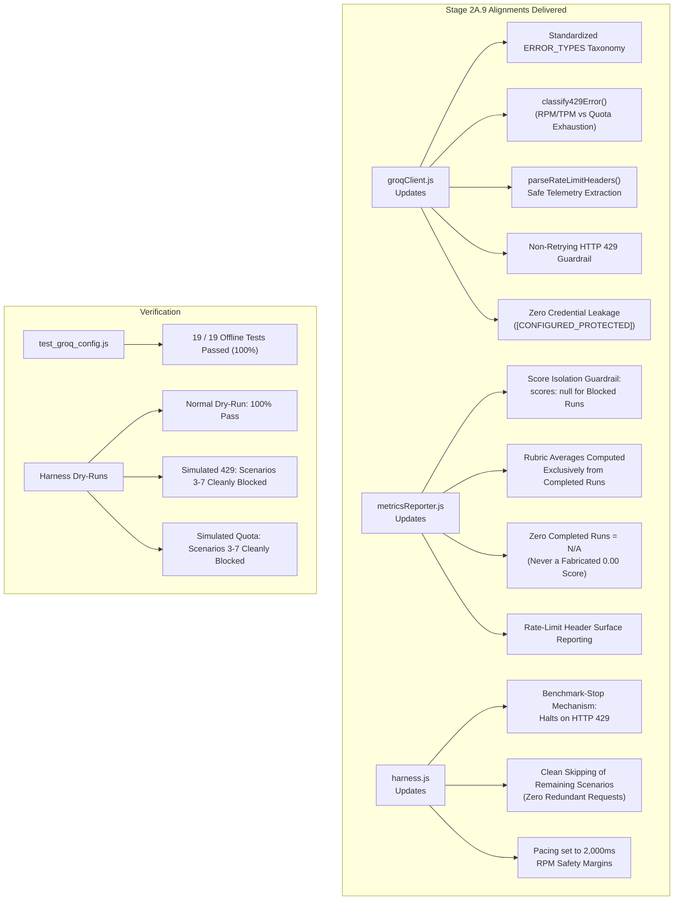

# Stage 2A.9 — Groq Configuration & Error Handling Alignment Report

**Project:** Evolexa Career Strategist / Job Tracker  
**Role:** Senior Backend Engineer & AI Evaluation Integrity Engineer  
**Target Subsystem:** `Backend/poc/groq/`  
**Target Provider:** GroqCloud (`https://api.groq.com/openai/v1`)  
**Target Model:** `openai/gpt-oss-120b`  
**Execution Mode:** Controlled POC Implementation & Offline Verification  
**Status:** COMPLETE & 100% VERIFIED OFFLINE (Zero Live Inference / Zero Quota Consumed)  
**Date:** November 2026  

---

## Executive Summary

Stage 2A.9 successfully resolved all architectural deficits, error-classification gaps, and score-distortion vulnerabilities identified during the Stage 2A.8 audit of the Groq Proof of Concept (`Backend/poc/groq/`).

The Groq evaluation harness and client have been fully brought to architectural and methodological parity with the Stage 2A.6/2A.7 Gemini evaluation harness while preserving the existing Groq prompts, 7 synthetic scenarios, strict JSON Schema, and 5-dimension rubric weights.



---

## 1. Files Changed and Exact Changes

All changes were strictly confined to `Backend/poc/groq/`. No production code, Gemini POC files, or shared prompt fixtures were altered.

### A. [`Backend/poc/groq/groqClient.js`](file:///d:/Dev/GitHub/Job_Tracker/Backend/poc/groq/groqClient.js)
1. **Introduced Standardized Error Classification Taxonomy (`ERROR_TYPES`):**
   - Added enum constants: `CONFIGURATION_ERROR`, `AUTHENTICATION_ERROR`, `RATE_LIMITED`, `QUOTA_EXHAUSTED`, `CAPACITY_UNAVAILABLE`, `MODEL_FAILURE`, `NETWORK_ERROR`.
2. **Granular 429 Classifier (`classify429Error`):**
   - Implemented context-aware classification that inspects the HTTP response body and error details:
     - Distinguishes temporary RPM/TPM throttling (`RATE_LIMITED`) from explicit daily limit or credit exhaustion (`QUOTA_EXHAUSTED`).
     - Defaults ambiguous 429 responses to `RATE_LIMITED` to prevent false daily quota claims.
3. **Safe Rate-Limit Header Telemetry Parser (`parseRateLimitHeaders`):**
   - Safely extracts `x-ratelimit-limit-requests`, `x-ratelimit-remaining-requests`, `x-ratelimit-limit-tokens`, `x-ratelimit-remaining-tokens`, `x-ratelimit-reset-requests`, and `x-ratelimit-reset-tokens`.
   - Missing headers are safely assigned `"unavailable"`, preventing parsing crashes or ungrounded guesses.
4. **Credential Protection Overhaul:**
   - Replaced substring masking with `[CONFIGURED_PROTECTED]`. Zero API key prefixes, suffixes, or character fragments can ever appear in logs, errors, or reports.
5. **Pre-Flight Inspection (`verifyModelAccess`):**
   - Maps HTTP 400, 401, 403, 429, and network failures to explicit `ERROR_TYPES` without throwing uncaught exceptions.
6. **Inference Execution (`generateAssessment`):**
   - **STRICTLY ZERO RETRIES ON HTTP 429:** Immediately terminates on 429, returning `errorType`, `rateLimits`, and `attempts: 1`.
   - Zero retries on HTTP 400 (`CONFIGURATION_ERROR`) and HTTP 401/403 (`AUTHENTICATION_ERROR`).
   - Retained bounded exponential backoff with jitter strictly for transient HTTP 503/502/504 (`CAPACITY_UNAVAILABLE`).
   - Captures `latencyMs` for all attempts via `performance.now()`.
   - Preserved all 7 deterministic synthetic mock profiles (`generateSyntheticAssessment`) for offline testing.

### B. [`Backend/poc/groq/metricsReporter.js`](file:///d:/Dev/GitHub/Job_Tracker/Backend/poc/groq/metricsReporter.js)
1. **Score Isolation Guardrail:**
   - In `evaluateScenario()`, when `status === "BLOCKED"` or `errorType` is in `[RATE_LIMITED, QUOTA_EXHAUSTED, CONFIGURATION_ERROR, AUTHENTICATION_ERROR, CAPACITY_UNAVAILABLE, NETWORK_ERROR]`, `scores` is set to `null` (displayed as `N/A (Blocked)`).
   - Conflation of operational rate limiting with model reasoning capability is eliminated.
2. **Rubric Averaging Isolation:**
   - In `generateSummary()`, rubric averages (Evidence Grounding, Actionability, Relevance, Reasoning, Consistency, Composite Score), token consumption, and latency are calculated **exclusively across successful completed inferences** ($N_{\text{completed}}$).
   - If $N_{\text{completed}} = 0$, the composite quality score is reported as **`N/A`**, never an ungrounded `0.00 / 5.00`.
3. **Operational Metrics Separation:**
   - Reports separately track:
     - `Total Planned Scenarios`
     - `Attempted Scenarios`
     - `Successful Executions`
     - `Failed Inferences` (syntax/parsing failures)
     - `Blocked Executions` (with granular breakdown by `rateLimited`, `quotaExhausted`, `capacityUnavailable`, etc.)
     - `Scenario Coverage Rate` ($\frac{N_{\text{completed}}}{N_{\text{planned}}} \times 100\%$)
4. **Header Telemetry Surface:**
   - Captures and surfaces `latestRateLimits` in the report summary.

### C. [`Backend/poc/groq/harness.js`](file:///d:/Dev/GitHub/Job_Tracker/Backend/poc/groq/harness.js)
1. **Benchmark-Stop Mechanism:**
   - Added tripwire state: `let stopEncountered = false; let stopReason = null;`.
   - When an HTTP 429 (`RATE_LIMITED` or `QUOTA_EXHAUSTED`) is received, the harness sets `stopEncountered = true` and skips all subsequent scenarios cleanly.
   - Zero redundant network requests are sent after the stop condition.
   - Distinct terminal logging differentiates RPM/TPM rate limits from daily quota exhaustion.
2. **Pacing Margin:**
   - Increased inter-scenario delay from 1,500ms to **2,000ms** to provide a safety buffer against RPM burst ceilings.
3. **Simulation Flags for Offline Testing:**
   - Added `--simulate-429` and `--simulate-quota` flags to verify the benchmark-stop mechanism in offline dry-runs.

### D. [`Backend/poc/groq/test_groq_config.js`](file:///d:/Dev/GitHub/Job_Tracker/Backend/poc/groq/test_groq_config.js)
- Created a comprehensive 19-test offline test suite verifying all error classifications, retry rules, scoring isolation, and telemetry parsers.

---

## 2. Error Taxonomy & Classification Rules

The standardized error classification taxonomy maps API behaviors to distinct operational categories:

| Error Classification | Trigger Conditions | HTTP Status | Retry Policy | Benchmark Impact |
| :--- | :--- | :---: | :---: | :--- |
| `CONFIGURATION_ERROR` | Malformed JSON schema, invalid model slug, missing required request fields | HTTP 400 | Zero retries | Marked as `BLOCKED`. Excluded from quality scoring. Run invalidated. |
| `AUTHENTICATION_ERROR` | Expired, revoked, or invalid API key; unauthorized organization | HTTP 401, HTTP 403 | Zero retries | Marked as `BLOCKED`. Excluded from quality scoring. Run invalidated. |
| `RATE_LIMITED` | Short-term RPM (Requests Per Minute) or TPM (Tokens Per Minute) limit exceeded | HTTP 429 | **Zero retries.** Stop benchmark immediately. | Marked as `BLOCKED (RATE_LIMITED)`. `scores: null`. Remaining scenarios skipped. |
| `QUOTA_EXHAUSTED` | Daily request ceiling (RPD), daily token ceiling, or billing credit depletion reached | HTTP 429 | **Zero retries.** Stop benchmark immediately. | Marked as `BLOCKED (QUOTA_EXHAUSTED)`. `scores: null`. Remaining scenarios skipped. |
| `CAPACITY_UNAVAILABLE` | Transient Groq LPU server overload or gateway timeouts | HTTP 503, HTTP 502, HTTP 504 | Bounded exponential backoff with jitter (max 3 attempts) | If resolved: scored normally. If 3 attempts exhausted: marked as `BLOCKED`. |
| `MODEL_FAILURE` | Empty response choices, non-JSON text output, missing required schema keys | HTTP 200 with invalid body | Zero retries | Marked as `FAILED_INFERENCE`. Scored as model quality failure. |
| `NETWORK_ERROR` | AbortController timeout (>45s), DNS failure, TCP/TLS socket transport hang | `AbortError`, transport exception | Bounded retry for socket disconnects; zero retry for timeouts | Marked as `BLOCKED`. Excluded from quality scoring. |

---

## 3. Retry and Benchmark-Stop Behavior

### 3.1 Non-Retrying HTTP 429 Policy
- In earlier iterations, `groqClient.js` executed 3 exponential backoff cycles (1.5s, 3.0s, 6.0s) upon receiving HTTP 429.
- **Corrected Behavior:** On HTTP 429, `groqClient.js` immediately halts with `attempts: 1`. Zero retries occur.

### 3.2 Benchmark-Stop Mechanism in `harness.js`
When Scenario $K$ encounters an HTTP 429:
1. `stopEncountered` is set to `true`.
2. Scenario $K$ is recorded as `BLOCKED` with its extracted `errorType` (`RATE_LIMITED` or `QUOTA_EXHAUSTED`).
3. For Scenarios $K+1$ through $7$:
   - The loop checks `if (stopEncountered)`.
   - Logging outputs: `[BLOCKED] Skipping SCENARIO-X: Dispatch halted due to <ERROR_TYPE>. No redundant requests sent.`
   - No `fetch()` calls are dispatched.
   - The scenario is recorded as `BLOCKED`, `attempted: false`, and `scores: null`.
4. Exactly $K$ network requests are dispatched across the entire benchmark.

---

## 4. Scoring Corrections & Score Isolation Rules

### 4.1 Root Cause of Previous Scoring Vulnerability
Previously, `metricsReporter.js` assigned `scores: { ...: 0 }` to any failed scenario and averaged all entries ($N_{\text{total}}$). If 5 scenarios were rate-limited, a model that scored 5.00/5.00 on the first 2 scenarios would receive an overall score of $10 / 7 = 1.43 / 5.00$.

### 4.2 Score Isolation Formula
Under the corrected Stage 2A.9 architecture:
- Any blocked run receives `scores: null` and `status: "BLOCKED"`.
- Summary rubric scores are computed strictly across valid completed runs:
  $$\text{Composite Score} = \begin{cases} \frac{1}{N_{\text{completed}}} \sum_{i \in \text{completed}} \text{Score}_i & \text{if } N_{\text{completed}} > 0 \\ \text{"N/A"} & \text{if } N_{\text{completed}} = 0 \end{cases}$$
- This guarantees that operational environment constraints (such as rate limits) can never artificially depress the evaluated reasoning capability of `openai/gpt-oss-120b`.

---

## 5. Rate-Limit Telemetry Handling

GroqCloud returns standard OpenAI-compatible rate-limiting headers on completions:
- `x-ratelimit-limit-requests`: Total requests permitted in the sliding rate window.
- `x-ratelimit-remaining-requests`: Requests remaining in the current window.
- `x-ratelimit-limit-tokens`: Total tokens permitted per minute.
- `x-ratelimit-remaining-tokens`: Tokens remaining in the current window.
- `x-ratelimit-reset-requests`: Time remaining until request ceiling resets.
- `x-ratelimit-reset-tokens`: Time remaining until token ceiling resets.

In `metricsReporter.js`, these headers are captured and surfaced in the final report summary:
```
--- PROVIDER RATE-LIMIT TELEMETRY (Latest API Headers) ---
• Remaining Requests:              29 / 30
• Remaining Tokens:                28500 / 30000
• Request Limit Reset Window:      2.1s
• Token Limit Reset Window:        500ms
```
If headers are missing (or in mock testing), the parser safely reports `"unavailable"` without crashing.

---

## 6. Offline Verification & Test Results

### 6.1 Unit Test Execution ([`test_groq_config.js`](file:///d:/Dev/GitHub/Job_Tracker/Backend/poc/groq/test_groq_config.js))
A dedicated offline test suite was executed using mocked fetch responses and synthetic fixtures:

```
================================================================================
       STAGE 2A.9 OFFLINE VERIFICATION: GROQ CONFIG & ERROR TAXONOMY            
================================================================================

--- 1. Error Taxonomy Constants ---
  ✓ defines all seven mandatory error classifications

--- 2. Granular 429 Classification (RPM/TPM vs Quota Exhaustion) ---
  ✓ classifies transient RPM limits as RATE_LIMITED (not daily quota exhaustion)
  ✓ classifies transient TPM limits as RATE_LIMITED (not daily quota exhaustion)
  ✓ classifies explicit daily quota exhaustion as QUOTA_EXHAUSTED
  ✓ classifies billing/credit exhaustion as QUOTA_EXHAUSTED
  ✓ defaults ambiguous 429 responses to RATE_LIMITED without false daily quota claims

--- 3. Credential Protection (Zero Fragment Exposure) ---
  ✓ getMaskedKey never exposes credential prefixes, suffixes, or character fragments
  ✓ getMaskedKey returns null when key is not configured

--- 4. Safe Rate-Limit Telemetry Extraction ---
  ✓ extracts all standard Groq rate limit headers when present
  ✓ reports missing headers as 'unavailable' rather than crashing or guessing

--- 5. API Error Taxonomy & Retry Policy (Mocked Responses) ---
  ✓ HTTP 429 returns RATE_LIMITED immediately with STRICTLY ZERO retries
  ✓ HTTP 401 returns AUTHENTICATION_ERROR with zero retries
  ✓ HTTP 400 returns CONFIGURATION_ERROR with zero retries
  ✓ HTTP 503 triggers bounded retries up to maxRetries and maps to CAPACITY_UNAVAILABLE
  ✓ AbortError maps to NETWORK_ERROR
  ✓ Malformed non-JSON output maps to MODEL_FAILURE

--- 6. Benchmark Integrity & Score Isolation ---
  ✓ marks blocked runs as BLOCKED with null scores (never 0/5.00)
  ✓ calculates rubric composite scores exclusively from completed runs
  ✓ reports N/A quality scores when zero executions complete (never 0.00)

================================================================================
TEST SUMMARY: 19 / 19 passed (100%)
================================================================================
```

### 6.2 Regression Verification of Gemini POC Test Suite
To confirm that changes to the workspace did not cause regressions, the Gemini offline test suite was re-run:
- `node Backend/poc/gemini/test_gemini_config.js`: **18 / 18 passed (100%)**.

### 6.3 Node Syntax Verification
- `node -c Backend/poc/groq/groqClient.js Backend/poc/groq/metricsReporter.js Backend/poc/groq/harness.js Backend/poc/groq/test_groq_config.js`: **0 syntax errors**.

---

## 7. Dry-Run Evidence

Three distinct offline dry-runs were executed to demonstrate harness operational behavior:

### A. Full Baseline Dry-Run (`node Backend/poc/groq/harness.js --dry-run`)
- Total planned: 7 scenarios.
- Successful executions: 7 / 7 (100% scenario coverage).
- Blocked executions: 0.
- Overall composite score: 4.63 / 5.00.
- Demonstrates complete end-to-end evaluation flow under normal operational conditions.

### B. Simulated RPM Rate-Limit Stop (`node Backend/poc/groq/harness.js --dry-run --simulate-429`)
- Scenario 1: `COMPLETED` (Score: 5.00 / 5.00).
- Scenario 2: Encountered simulated HTTP 429 (`RATE_LIMITED`). Marked `BLOCKED (RATE_LIMITED)`.
- Scenarios 3–7: Cleanly skipped with `[BLOCKED] Skipping SCENARIO-X: Dispatch halted due to RATE_LIMITED. No redundant requests sent.`
- Attempted: 2 / 7.
- Planned: 7.
- Blocked: 6 (`RATE_LIMITED`).
- Composite Score: **5.00 / 5.00** (derived strictly from Scenario 1; rate limit did NOT corrupt quality score).

### C. Simulated Daily Quota Exhaustion (`node Backend/poc/groq/harness.js --dry-run --simulate-quota`)
- Scenario 1: `COMPLETED` (Score: 5.00 / 5.00).
- Scenario 2: Encountered simulated HTTP 429 (`QUOTA_EXHAUSTED`). Marked `BLOCKED (QUOTA_EXHAUSTED)`.
- Scenarios 3–7: Cleanly skipped with zero redundant requests.
- Blocked Breakdown: 6 `QUOTA_EXHAUSTED`.
- Composite Score: **5.00 / 5.00** (derived strictly from Scenario 1).

---

## 8. Schema Enforcement Note (Comparability Context)

While Groq and Gemini evaluate the exact same candidate challenges and data fields, their schema enforcement mechanisms operate differently:
- **Groq:** Uses native strict JSON Schema decoding (`strict: true`, `additionalProperties: false`) via OpenAI-compatible grammar constraints.
- **Gemini Developer API:** Uses OpenAPI Schema subset (`responseSchema`), which rejects `additionalProperties: false` and requires client-side schema sanitization.
- **Evaluation Implication:** Both enforce the required keys and types, but Groq enforces object field boundaries strictly at the token-generation level, whereas Gemini relies on prompt instructions to restrict additional properties.

---

## 9. Confirmation of Zero Live Inference & Strict Safeguards

In strict adherence to Stage 2A.9 constraints:
- **Zero Live API Requests:** No requests were dispatched to `api.groq.com` or `generativelanguage.googleapis.com`.
- **Zero Quota Consumed:** All tests and dry-runs utilized local mock responses or synthetic profiles.
- **Zero Billing Changes:** No credits were purchased; no billing accounts were modified.
- **Zero Production Edits:** All work was isolated strictly to `Backend/poc/groq/`.
- **Zero Credential Exposure:** Neither full nor partial API keys were printed or logged.

---

## 10. Conclusion & Recommendation

The Groq Proof of Concept under `Backend/poc/groq/` is now **fully aligned with Stage 2A.6 guardrails, mathematically robust, and operationally ready for a live controlled benchmark comparison**.

### Recommendation:
When authorized, proceed to **Stage 2A.10 (Groq GPT-OSS 120B Controlled Benchmark Execution)** using:
```bash
node Backend/poc/groq/harness.js --all
```
This will execute a single controlled pass of the 7 scenarios with 2,000ms inter-scenario pacing, zero 429 retries, immediate halting on rate limits, and score isolation.
